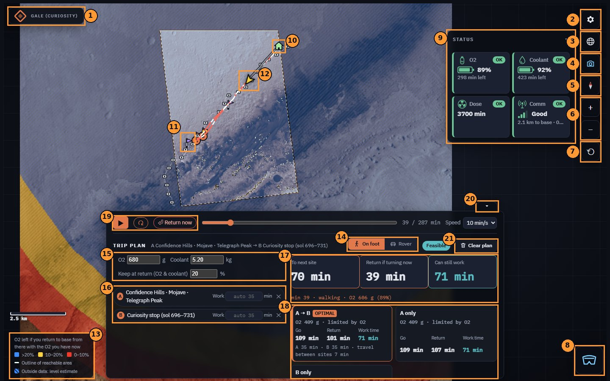
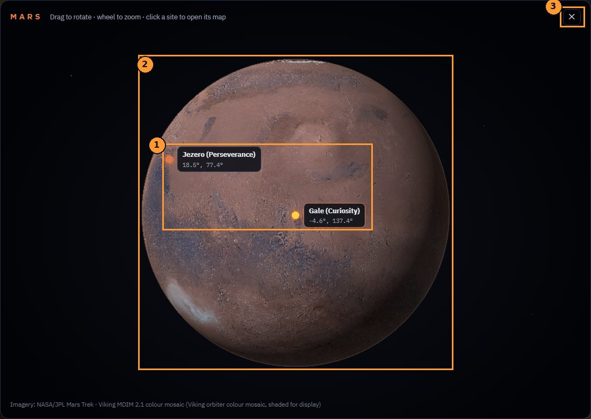
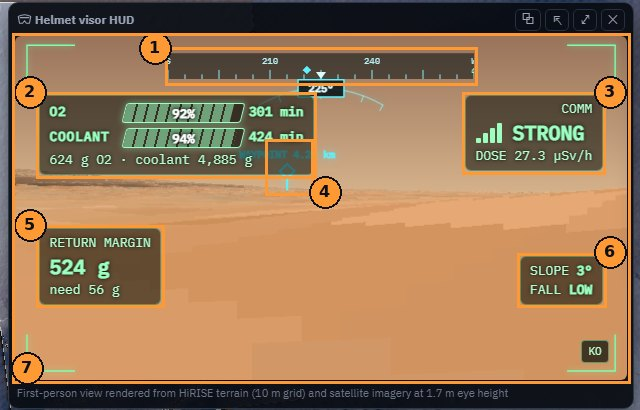

# Mars EVA Walkback & Survival Planner (화성 EVA 귀환·생존 계획 도구)

**NASA Space Apps 2026 · Interplanetary Survival Guide: Martian Map** · [English](README.md) | 한국어

> ### 지금 무언가 고장 나면, 우주인은 걸어서 거점까지 돌아올 수 있을까?

남은 산소·냉각수·방사선 여유로 **EVA 대원이 살아서 돌아올 수 있는 곳**, 어느 지점에서든 **가장 안전한 귀환 경로**,
그리고 조사하고 싶은 지점에서 **얼마나 오래 작업할 수 있는지**를 보여 주는 10 m 해상도 화성 지도입니다.

**▶ 데모:** [`reports/18-eva-walkback-demo.html`](reports/18-eva-walkback-demo.html) — 설치 없이 오프라인으로 열리는 HTML 파일 하나입니다.
GitHub는 HTML을 실행하지 않고 소스로 보여 주므로, 링크에서 **Download raw file**을 눌러 받은 뒤 더블클릭하세요
(데스크톱 Chrome/Edge, 가로 1440 px 이상 권장).
플래너가 들어간 발표 페이지는 [`submission/Martian-Map-NASAJOIM.html`](submission/Martian-Map-NASAJOIM.html)입니다.

### 60초 체험

1. 처음에는 **Gale 크레이터**가 열립니다. 집 모양이 거점, 화살표가 대원입니다.
2. **깃발**(Curiosity가 실제로 조사한 지점)을 한두 개 누르세요. 계획 카드에 가는 시간·복귀 시간·작업 시간이 나오고 **OPTIMAL** 계획이 자동으로 골라집니다.
3. **▶**를 누르면 산소를 쓰면서 색 영역이 줄어드는 것이 보입니다. **Return now**를 누르면 그 자리에서 바로 돌아섭니다.
4. 오른쪽 아래 **바이저**로 대원의 1인칭 시점을, **지구본**으로 Jezero·Aram Chaos 전환을 해 보세요.

### 챌린지 요구사항과의 대응

| 챌린지가 요구한 것 | 이 플래너에서 |
|---|---|
| 지표 탐사 중 우주인이 쓸 수 있는 지도·도구 | 전체 화면 플래너, 탐사 계획 카드, 헬멧 바이저 화면 |
| 3종 이상의 NASA 자료를 겹쳐 쓰기 | 지형(HiRISE DTM), 광학(HiRISE·CTX·Viking 지구본), 열(THEMIS), 방사선(Curiosity RAD), 로버 이동 경로·Navcam 사진 |
| 우주인 안전 최우선 | 10 m 칸마다 실제 귀환 경로로 산소·냉각수·선량·통신 확인, 회항 경보와 **Return now** |
| 우주복·장비를 갖춘 이동성 | NASA 우주복 보행 시험(IST)으로 보행 비용 계산, 경사 20° 초과는 통행 불가, 지형 기복·모래는 비용 증가 |
| 장애물을 피하는 경로 | 지형 위 산소 최소 경로, 통행 불가 지점은 가장 완만한 길로 |
| 탐사 중 과학 | 지점은 Curiosity·Perseverance가 실제로 조사한 곳(드릴·시료 채취 지점), 깃발에 마우스를 올리면 한 일을 보여 줌 |
| 1인칭 시점 이미지 | 정지 지점 근처 로버 Navcam 사진(로드뷰)과 지형으로 그린 1인칭 화면 |
| 로버·2인 1조 운용 | 로버 모드와 Apollo walk-back 규칙: 로버가 고장 나도 모든 지점에서 걸어서 귀환 가능해야 함 |
| 헬멧 바이저 HUD | 방위, 산소·냉각수, 통신, 귀환 여유, 경사·넘어짐 위험 |

### 동작 원리

1. **지형:** HiRISE 1 m DTM을 10 m 격자로 평균하고, 이웃 칸(16방향) 사이 경사와 1 m 고도에서 구한 기복 계수를 씁니다.
2. **대사 비용:** 걷는 속도와 걸음마다의 산소 소모는 NASA IST 우주복 보행 회귀식을 화성 중력에 적용해 구합니다(평지 0.92 m/s에서 444 W). 냉각수는 버려야 할 열에서 계산합니다.
3. **경로:** 거점에서 시작하는 Dijkstra 탐색으로 모든 칸에 대해 가는 데와 돌아오는 데 드는 최소 산소를 구합니다.
4. **영역과 계획:** 왕복하고도 출발 산소의 20 % 넘게 남으면 파랑입니다. 계획은 설정한 복귀 여유를 지키면서 남는 시간을 지점별 작업 시간으로 나눕니다.

모든 식과 계산 예시: [docs/METHODS.ko.md](docs/METHODS.ko.md)

### 주요 기능

- **귀환 가능 영역:** 10 m 칸마다 실제 귀환 경로로 산소·냉각수·선량·통신을 확인하고, 왕복 뒤 남는 산소를 색으로 보여 줍니다(>20 %, 10–20 %, 0–10 %).
- **탐사 계획:** 산소·냉각수·복귀 여유를 넣고 지점을 최대 세 곳 고르면 **최적 방문 순서와 지점별 작업 시간**을 정합니다.
- **재생과 회항:** 계획을 분 단위로 재생하며 영역이 줄어드는 모습, **회항 경보**, **Return now** 버튼을 보여 줍니다.
- **가기 어려운 지점:** 경사 20°가 넘는 비탈 너머 지점도 가장 완만한 길로 갈 수 있습니다(경고 표시).
- **화성 지구본의 세 지역:** Gale(Curiosity), Jezero(Perseverance), Aram Chaos. 고도 자료 밖 둘레는 배경으로 보여 줍니다.
- **헬멧 바이저:** 지형으로 그린 1인칭 화면에 방위, 산소·냉각수 막대, 통신, 귀환 여유를 표시합니다.

### 사용법

**머리줄과 오른쪽 도구**
1. **현재 지역** — 지도에 보이는 지역.
2. **설정**(톱니) — 언어, 상황(과학 EVA 포함), 산소·냉각수, 태양 입자 사건(SPE), 안전 옵션(표토, 모래언덕 자료가 있는 지역의 모래 계수), 지도 레이어. 오른쪽에서 열립니다.
3. **지구본** — 화성 지구본(아래)에서 Gale·Jezero·Aram Chaos를 고릅니다. 지역을 바꾸면 고른 지점은 지워집니다.
4. **로드뷰** — 각 정지 지점 근처에서 로버가 실제로 찍은 사진(NASA/JPL Navcam).
5. **N** — 정북 위 ↔ 목표 방향 위(지금 가는 목표가 화면 위로). 대원 위치를 축으로 부드럽게 돕니다.
6. **확대·축소** — 마우스 휠도 됩니다. 어디서든(고도 자료 밖 포함) 끌어서 이동합니다.
7. **원래 보기**.
8. **바이저**(오른쪽 아래) — 헬멧 1인칭 시점(아래).
9. **상태** — 지금 산소·냉각수·선량·통신. 제목을 끌어 옮기고(두 번 누르면 원래 자리), 짧게 누르면 접힙니다.

**지도**

10. **거점**(집) — 대원(화살표)이 여기서 출발합니다. 집을 끌어 옮기면 대원도 함께 옮겨지고 경로와 영역이 다시 계산됩니다. 설정 › 상황에서 착륙지로 되돌릴 수 있습니다.
11. **과학 지점**(깃발) — 로버가 실제로 조사한 곳. 마우스를 올리면 그곳에서 한 일이 나오고, 누르면 계획에 넣습니다(최대 세 곳: A, B, C). 고도 자료가 있는 다른 지점도 고를 수 있습니다. 자료 밖은 경사를 몰라 경로·산소를 계산할 수 없어서 고를 수 없습니다.
12. **대원** — 재생 중 화살표가 걷는 방향을 가리킵니다.
13. **범례** — 색 = 거점에서 왕복한 뒤 남는 산소(>20 %, 10–20 %, 0–10 %). 빗금 = HiRISE 띠 밖의 평지 가정 추정.

**탐사 계획 카드**

14. **도보 / 로버** — 카드를 접어도 보입니다.
15. **자원** — 산소(g), 냉각수(kg), 복귀 때 남길 여유(%). 여유는 지도 색이 아니라 작업 시간과 돌아서는 시점을 바꿉니다(1 % → 작업 140분, 약 8 g 남기고 도착).
16. **지점과 작업 시간** — 지점마다 분을 넣거나, 비워 두면 최적값(흐리게 표시)을 씁니다. ×로 지점을 뺍니다.
17. **시간** — 가는 시간·복귀 시간·작업 시간. 재생 중에는 다음 지점까지, 지금 돌아서면 복귀까지, 더 작업할 수 있는 시간.
18. **시나리오** — 고른 지점의 모든 조합과 순서. **OPTIMAL**(지점 가장 많이, 그다음 작업 시간 가장 길게)이 기본이고, 다른 카드를 누르면 그 계획을 씁니다.
19. **재생** — ▶ 재생/일시정지, ↺ 처음으로, **Return now**(그 자리에서 거점으로 돌아가기), 속도.
20. **접기** — 카드를 접어 지도를 넓게 봅니다.
21. **계획 초기화**(휴지통) — 고른 지점을 모두 지웁니다.

**과학 EVA**(설정 › 상황): 아래 카드가 *SCIENCE EVA PLAN*으로 바뀌고 로버 조사 지점, 작업 시간, 방문 순서가 나옵니다. 카드 오른쪽 위 ✕로 탐사 계획으로 돌아갑니다.

재생 중에는 지도 아래로 스크롤하면 실시간 그래프(심박, 보정계수 k, 쓸 수 있는 산소 vs 귀환에 필요한 산소)가 있습니다.

1. **지역 핀** — Gale(Curiosity), Jezero(Perseverance), Aram Chaos를 위경도 위치에 표시합니다. 누르면 그 지도가 열립니다.
2. **지구본** — 끌어서 돌리고 휠로 확대합니다. 영상: NASA/JPL Mars Trek, Viking MDIM 2.1 컬러 모자이크.
3. **닫기**.

1. **방위**(0–360°)와 거점(⌂)·목표(◆) 표시.
2. **산소와 냉각수** — 막대 안에 %, 옆에 남은 분.
3. **통신** — 거점과의 신호 세기, 선량률.
4. **목표 지점** — 다음 지점과 거리(시야 밖이면 화면 가장자리에 화살표).
5. **귀환 여유** — 여기서 걸어서 돌아간 뒤 남는 산소와, 귀환에 필요한 산소.
6. **경사와 넘어짐 위험**(지금 칸).
7. 바이저를 **끌면** 360° 둘러보고, 두 번 누르면 걷는 방향으로 돌아옵니다. ⧉는 별도 창으로 엽니다. 사진이 아니라 10 m 지형으로 그린 화면입니다.

### 신뢰할 수 있는 이유

- **우주복 실측 자료:** 보행 비용은 NASA IST-1/2 감소 중력 우주복 보행 시험에서 나옵니다(평지 444 W).
- **모든 식을 계산 예시와 함께 공개:** [docs/METHODS.ko.md](docs/METHODS.ko.md) · [English](docs/METHODS.md), 지형계수 η: [docs/TERRAIN.ko.md](docs/TERRAIN.ko.md).
- **독립 검증:** [`walkback_verification/`](walkback_verification/)에서 모델을 따로 다시 구현했고 데모와 일치합니다(**Gale, 산소 150 g → 9.72 km²**).
- **모델 선택의 영향:** 예전 Pandolf × 중력 모델은 같은 조건에서 **면적을 2배**로 계산합니다. 그래서 우주복 보행 실측(IST)을 씁니다.

### NASA 자료

HiRISE 1 m DTM과 정사영상 · MRO CTX 모자이크(둘레) · Curiosity·Perseverance 이동 경로와 Navcam 사진 ·
Mars 2020 시료 목록 · JPL Mars Trek THEMIS 야간 적외선과 Viking MDIM 2.1 컬러 모자이크(지구본) · Curiosity RAD.
지역: **Gale**, **Jezero 삼각주**, **Aram Chaos**.

### 사용한 자료와 쓰는 방법

| 자료 (출처) | 제품·내용 | 플래너에서 쓰는 방법 |
|---|---|---|
| HiRISE DTM (NASA PDS, 애리조나대) | Gale `DTEEC_018854_1755_018920_1755`, Jezero `DTEEC_045994_1985_046060_1985`, Aram Chaos `DTEEC_054753_1825_055452_1825`, 1 m | 10 m 격자로 평균 → 칸 사이 경사(16방향, 20° 초과 통행 불가), 1 m 기복으로 지형계수 η, 통신 가시선, 바이저 1인칭 지형 |
| HiRISE 정사영상 | 같은 띠, 적색 밴드 | 지도 바탕 사진, 바이저 지면 색, 모래언덕 후보(Gale: 밝기로 찾은 어두운 현무암질 모래) → 선택형 모래 계수 |
| MRO CTX 모자이크 (Mars Trek / Esri OnMars, Jezero 6 m 정사 모자이크) | 각 띠의 둘레 | 배경 전용, 영상 상관으로 HiRISE에 위치 맞춤. 경로 계산에는 쓰지 않음 |
| Curiosity·Perseverance 이동 경로 (NASA MMGIS waypoint) | sol별 로버 위치·체류 | 지도의 이동 경로 선, 과학 지점 = 로버가 가장 오래 머물며 드릴·시료 채취한 곳 |
| Mars 2020 시료 목록 | 시료 번호·이름·sol | Jezero 지점의 이름과 설명(깃발 툴팁) |
| Navcam 원본 사진 (NASA/JPL) | 정지 지점 근처 사진 | 로드뷰: 실제 지상 사진 |
| THEMIS 야간 적외선 (JPL Mars Trek) | 열관성, 약 100 m | Aram Chaos 과학 후보(열관성 높은 노출 암반), 선택형 지도 레이어 |
| Curiosity RAD (Hassler 외 2014) | 지표 선량 0.655 mSv/일, 관측된 SPE ×2.9 | 경로별 선량(지형 차폐 대리값 포함)을 1 mSv 예산과 비교, SPE 상황 |
| Viking MDIM 2.1 컬러 모자이크 (JPL Mars Trek) | 전구, 2048 × 1024 | 지역을 고르는 3D 지구본 |
| NASA IST-1/2 우주복 보행 시험 (TP-2010-216115/-216125) | 속도·경사별 VO2 | 화성 중력에서 걷는 속도와 걸음마다 산소, 버릴 열에서 냉각수 |
| Apollo 15–17 PLSS | 산소 680 g, 물 5.2 kg | 기본 출발 소모품 |
| 셔틀·ISS EVA 심박 자료 (Hoffmann 외 2021) | 심박 → 대사량 | 실시간 그래프의 보정계수 k(합성 심박 시나리오) |

### 실측 자료와 모델의 구분

| 실측·공개 자료 (NASA) | 모델·시나리오 (우리가 계산하거나 정한 값) |
|---|---|
| HiRISE 1 m DTM과 정사영상 | 보행 대사량(NASA IST 시험 회귀식을 화성 중력에 외삽) |
| Curiosity·Perseverance 이동 경로, 정지 지점, Navcam 원본 사진 | 귀환 경로, 귀환 가능 면적, 작업 시간(Dijkstra 결과) |
| Mars 2020 시료 목록 | 실시간 그래프의 심박 원격측정(합성 시나리오) |
| Curiosity RAD 배경 선량, 관측된 SPE ×2.9 | 선량 예산 1 mSv, 지형 차폐 대리값, 큰 SPE 배수 |
| Apollo 15–17 PLSS 소모품(산소 680 g, 물 5.2 kg) | 로버 속도와 탑승 대사량, 넘어짐 위험·통신 막대 대리값 |
| JPL Mars Trek THEMIS 야간 적외선, Viking 컬러 모자이크 | 10 m 지형으로 그린 1인칭 바이저(사진 아님), 고도 자료 밖 색(평지 가정 추정) |

### 한계

- 우주복 시험은 지구에서 0.12–0.32 g로 했고 화성 중력에서 한 것이 아닙니다. 내리막 비용은 축소 외삽입니다.
- 10 m 격자는 칸보다 작은 바위를 평평하게 만듭니다. 기복은 바위 부담의 대리값이지 바위 개수가 아닙니다.
- HiRISE 고도 띠 밖은 경사 자료가 없어 색이 평지 가정 추정이고, 지점으로 고를 수 없습니다.
- 심박 원격측정은 합성 시나리오이고, 로버 속도와 탑승 대사량은 가정입니다.
- 지형 차폐, 넘어짐 위험, 통신 막대는 측정값이 아닌 대리값입니다. 실제 EVA 안전 시스템이 아니라 계획용 데모입니다.

### 저장소 구성

| 경로 | 내용 |
|---|---|
| `reports/18-eva-walkback-demo.html` | 플래너(빌드된 단일 파일) |
| `submission/` | 플래너가 들어간 발표 페이지와 그 빌드 스크립트 |
| `code/demo_template.html`, `code/i18n_en.js` | 플래너 원본과 영어 사전 |
| `code/build_demo_html.py` | 원본과 준비된 지형 자료로 플래너를 빌드 |
| `walkback_verification/` | 귀환 모델의 독립 재구현 |
| `docs/` | 계산 방법, 지형계수, 설명서 이미지 |

---

다시 빌드: `cd code && python build_demo_html.py` · 프로젝트 초기의 SLAM·지형 AI 연구:
[Martian_SLAM](https://github.com/jstak0804/Martian_SLAM) · AI 코딩 도우미(Claude Code)를 활용해 만들었습니다. 모든 영상은 NASA/JPL-Caltech.
