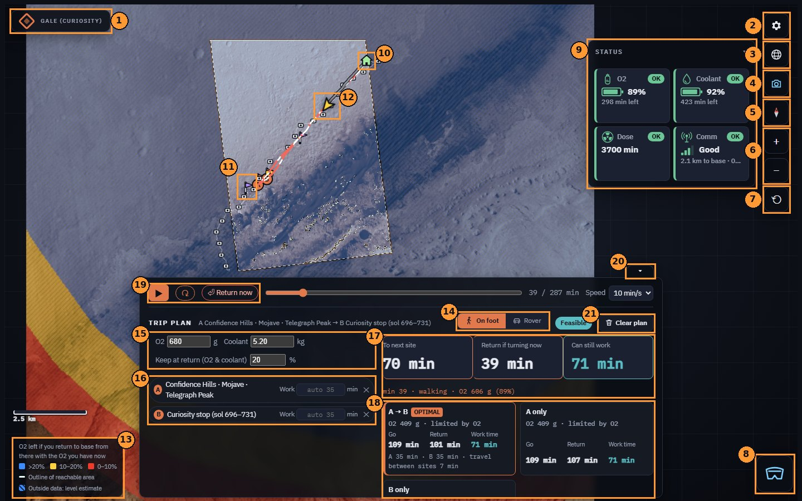
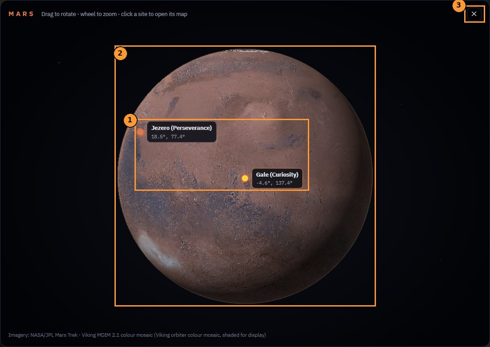
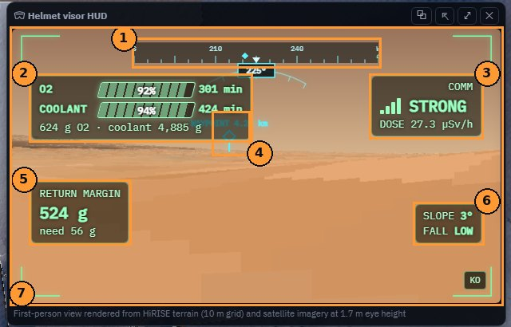

# How to Use our Martian-Map

**NASA Space Apps 2026 · Interplanetary Survival Guide: Martian Map** · English | [한국어](README.ko.md)

> ### If something breaks right now, can the astronaut still walk back to base?

A 10 m map of Mars that shows **where an EVA crew can still get home alive** with the oxygen, coolant
and radiation margin they have left, **the safest way back** from any point, and **how long they can work**
at the sites they want to study.

**▶ Demo:** [`reports/18-eva-walkback-demo.html`](reports/18-eva-walkback-demo.html) — one self-contained HTML file (no install, works offline).
GitHub shows the source of HTML files, so open the link, press **Download raw file**, then double-click the file
(desktop Chrome/Edge, best at 1440 px wide or more).

### Try it in 60 seconds

1. The map opens on **Gale crater**; the house is the base and the arrow is the crew.
2. Click one or two **flags** (sites Curiosity actually studied). The plan card shows go / return / work time and picks the **OPTIMAL** plan.
3. Press **▶** — watch the coloured zone shrink as O2 is used, then press **Return now** to turn back at once.
4. Open the **visor** (bottom-right) for the crew's first-person view, or the **globe** to switch to Jezero or Aram Chaos.

### How it answers the challenge

| Challenge asks for | In this planner |
|---|---|
| A map or tool an astronaut could use on a surface mission | Full-screen planner, trip plan card and a helmet visor view |
| At least three kinds of NASA data, layered | Topographic (HiRISE DTM), optical (HiRISE, CTX, Viking globe), thermal (THEMIS, Aram site selection), radiation (Curiosity RAD), rover traverses and Navcam images |
| Astronaut safety first | Every 10 m cell is checked for O2, coolant, dose and comms on the actual walk home; a turn-back alarm and **Return now** |
| Mobility in a suit, with equipment | Walking cost from NASA suited-walking tests (IST); slopes over 20° are impassable; terrain roughness and sand raise the cost |
| A route that avoids obstacles | Lowest-O2 routes over the terrain; impassable sites are reached by the gentlest route |
| Science along the way | Sites are places Curiosity and Perseverance studied (drill and sample sites); hover a flag for what was done there |
| Point-of-view images | Rover Navcam photos near each stop (Roadview) and a first-person view rendered from the terrain |
| Rovers / pairs of astronauts | Rover mode with the Apollo walk-back rule: every site must stay walkable home if the rover fails |
| A HUD on the helmet visor | Visor with heading, O2/coolant, comms, return margin, slope and fall risk |

### How it works

1. **Terrain:** HiRISE 1 m DTMs are averaged to a 10 m grid; slope between neighbouring cells (16 directions) and a roughness factor come from the 1 m heights.
2. **Metabolic cost:** walking speed and O2 use per step come from NASA IST suited-walking regressions at Mars gravity (444 W on level ground at 0.92 m/s); coolant follows from the heat to be rejected.
3. **Routes:** Dijkstra searches from the base give, for every cell, the lowest O2 needed to come back and to get there.
4. **Zones and plans:** a cell is blue if a round trip leaves more than 20 % of the starting O2; the planner then splits the remaining time into work time per site, keeping the return reserve you set.

All formulas with worked examples: [docs/METHODS.md](docs/METHODS.md).

### Key features

- **Walk-back zone:** every 10 m cell is checked for O2, coolant, dose and comms on the real return route; colours show the O2 left after a round trip (>20 %, 10–20 %, 0–10 %).
- **Exploration planner:** enter O2, coolant and a return reserve, pick up to three sites, and it chooses the **optimal visit order and work time per site**.
- **Playback with turn-back:** the plan plays minute by minute with a shrinking zone, a **turn-back alarm** and a **Return now** button.
- **Hard-to-reach sites:** a site behind slopes over 20° is still reachable by the gentlest route (with a warning).
- **Three regions on a Mars globe:** Gale (Curiosity), Jezero (Perseverance) and Aram Chaos; surroundings beyond the elevation data are shown as context.
- **Helmet visor:** first-person view from the terrain model with heading, O2/coolant bars, comms and return margin.

### How to use

**Header and right tool column**
1. **Current region** — the region shown on the map.
2. **Settings** (gear) — language, situations (incl. Science EVA), O2 and coolant sliders, solar particle event, safety options (regolith, dune factor where dune data exist), map layers. Opens from the right.
3. **Globe** — opens the Mars globe (below) to pick Gale, Jezero or Aram Chaos. Switching clears the picked sites.
4. **Roadview** — real rover photos (NASA/JPL Navcam) taken near each stop.
5. **N** — north up ↔ target up (the current destination points to the top); the map turns smoothly around the crew position.
6. **Zoom** — or the mouse wheel; drag anywhere (also outside the elevation data) to pan.
7. **Reset view**.
8. **Visor** (bottom-right) — helmet first-person view (see below).
9. **Status** — O2, coolant, dose and comms right now. Drag the title to move the card (double-click puts it back); a short click folds it.

**Map**

10. **Base** (house) — the crew (arrow) starts here. Drag the house to move the base; the crew moves with it and routes and zones are recomputed. Settings › Situation can return it to the landing site.
11. **Science sites** (flags) — places the rovers actually studied. Hover a flag for what was done there; click to add it to the plan (up to three: A, B, C). Any other point with elevation data can be picked too; areas outside the data cannot be picked, because no slope means no route or O2 can be computed there.
12. **Crew** — the arrow points in the walking direction during playback.
13. **Legend** — colour = O2 left after a round trip from base (>20 %, 10–20 %, 0–10 %); hatched = level-ground estimate outside the HiRISE strip.

**Trip plan card**

14. **On foot / Rover** — stays visible when the card is folded.
15. **Resources** — O2 (g), coolant (kg) and the reserve (%) to keep on return. The reserve changes work time and when the crew turns back (1 % → work 140 min, back with about 8 g), not the map colours.
16. **Sites and work time** — type minutes per site, or leave blank for the optimal value (shown faintly). × removes the site.
17. **Times** — go, return and work time; during playback: time to the next site, return time from here, work time still possible.
18. **Scenarios** — every subset and order of the picked sites. The one marked **OPTIMAL** (most sites, then longest work time) is used unless you pick another.
19. **Playback** — ▶ play / pause, ↺ restart, **Return now** (stop the plan and walk back from here), speed.
20. **Fold** the card to see more of the map.
21. **Clear plan** (trash) — remove all picked sites.

**Science EVA** (Settings › Situation): the bottom card becomes *SCIENCE EVA PLAN* (rover-studied targets, work time, visit order); ✕ at its top right returns to the exploration plan.

During playback, scroll below the map for the live chart (heart rate, correction factor k, usable O2 vs O2 needed to return).

1. **Region pins** — Gale (Curiosity), Jezero (Perseverance) and Aram Chaos at their latitude and longitude; click one to open its map.
2. **Globe** — drag to rotate, wheel to zoom. Imagery: NASA/JPL Mars Trek, Viking MDIM 2.1 colour mosaic.
3. **Close**.

1. **Heading** (0–360°) with base (⌂) and target (◆) marks.
2. **O2 and coolant** — % inside the bar, minutes left beside it.
3. **Comms** — signal strength to the base, and dose rate.
4. **Waypoint** — the next site and its distance (an arrow at the screen edge when it is out of view).
5. **Return margin** — O2 left after walking home from here, and the O2 that return needs.
6. **Slope and fall risk** at the current cell.
7. **Drag** the visor to look around 360°; double-click to face the walking direction again. ⧉ opens it as a separate window. The view is rendered from the 10 m terrain, not a photograph.

### Why it is credible

- **Measured suit data:** walking cost comes from NASA IST-1/2 reduced-gravity suited walking tests (444 W on level ground).
- **All formulas, with worked examples:** [docs/METHODS.md](docs/METHODS.md) · [한국어](docs/METHODS.ko.md); terrain factor η: [docs/TERRAIN.md](docs/TERRAIN.md) · [한국어](docs/TERRAIN.ko.md).
- **Independently verified:** the model was re-derived in [`walkback_verification/`](walkback_verification/), and the demo matches it (**Gale, 150 g O2 → 9.72 km²**).
- **Model choice matters:** the older Pandolf × gravity model gives **2× the area** on the same check, which is why the planner uses the IST suited-walking data.

### NASA data

HiRISE 1 m DTMs and orthoimages · MRO CTX mosaics (surroundings) · Curiosity and Perseverance traverses and Navcam images ·
Mars 2020 sample list · JPL Mars Trek THEMIS night IR (Aram sites) and Viking MDIM 2.1 colour mosaic (globe) · Curiosity RAD.
Sites: **Gale**, **Jezero delta**, **Aram Chaos**.

### Data and how each is used

Checked against what is embedded in the planner file. "Gale / Jezero / Aram" marks where each item is available.

| Data (source) | Product / detail | How the planner uses it | Sites |
|---|---|---|---|
| HiRISE DTMs (NASA PDS, U. Arizona) | Gale `DTEEC_018854_1755_018920_1755`, Jezero `DTEEC_045994_1985_046060_1985`, Aram Chaos `DTEEC_054753_1825_055452_1825`; 1 m | Averaged to a 10 m grid → slope of each move (16 directions; moves steeper than 20° are impassable), roughness factor η from 1 m relief, terrain-shielding proxy for dose, comms line of sight, first-person visor terrain | All three |
| HiRISE orthoimages (same observations, RED) | 1 m-class image | Map base image and visor ground colour; dark basaltic sand found by brightness → optional dune factor | Base image: all; dune factor: Gale only |
| MRO CTX mosaics | Global CTX mosaic (Caltech Murray Lab, via Esri OnMars) for Gale and Aram; Mars 2020 CTX 6 m orthomosaic for Jezero | Background around the HiRISE strip only, aligned to HiRISE by image correlation; not used for routes | All three |
| Rover traverses (NASA MMGIS `MSL_waypoints`, `M20_waypoints`, `M20_traverse`) | Positions and stays by sol | Traverse line on the map; science sites = places the rover stayed longest (Gale also with drill sols from NASA releases) | Gale, Jezero |
| Mars 2020 rock-sample list (NASA science.nasa.gov) | Sample number, name, sol sealed | Matched to Perseverance stays by sol → names and descriptions of the Jezero sites | Jezero |
| Navcam raw images (Mars 2020 and MSL raw-image API, NASA/JPL-Caltech) | Left Navcam full frames | Camera markers and Roadview photos at rover stops (Jezero grouped by camera azimuth) | Gale, Jezero |
| THEMIS night IR (JPL Mars Trek) | Thermal inertia mosaic, ~100 m | Picks the Aram Chaos science sites (top 8 % thermal inertia = consolidated bedrock); not shown as a map layer | Aram |
| Curiosity RAD (Hassler et al. 2014; Zeitlin et al. 2018) | 0.655 mSv/day surface background; SPE ×2.9 observed in Sept 2017 | Dose along each route (reduced up to 50 % by the terrain-shielding proxy) against a 1 mSv per-return budget; SPE situations. Gale value applied to all sites | All three |
| Viking MDIM 2.1 colour mosaic (JPL Mars Trek) | Global, 2048 × 1024 | 3D globe for choosing the region | — |
| NASA IST-1/2 suited-walking tests (TP-2010-216115 / -216125) | VO2 vs speed and grade | Walking speed and O2 per step at Mars gravity (444 W level); downhill scaled with Looney et al. 2019; coolant from the heat to reject | All three |
| Apollo 15–17 PLSS; Waligora & Horrigan (NASA) | 680 g O2, 5.2 kg water; 352 W design average | Starting consumables and the 30-min O2 reserve | All three |
| Shuttle/ISS EVA heart rate (Hoffmann et al. 2021, NASA) | Heart rate → metabolic rate | Correction factor k in the live chart; the heart-rate trace itself is a synthetic scenario | All three |

Reviewed during research but **not used in the final planner**: Mars 2020 PIXL / SuperCam / SHERLOC (PDS Geosciences), Navcam meshes,
MSL REMS weather, MOLA global basemap, Apollo 15–16 time-and-motion studies.

### Observed data vs. models

| Observed / published data (NASA) | Models and scenarios (computed or chosen by us) |
|---|---|
| HiRISE 1 m DTMs and orthoimages | Walking metabolism (regression on NASA IST tests, extrapolated to Mars gravity) |
| Curiosity / Perseverance traverses, stops, Navcam raw images | Return routes, walk-back areas, stay times (Dijkstra results) |
| Mars 2020 sample list | Heart-rate telemetry in the live chart (synthetic scenario) |
| Curiosity RAD background dose, observed SPE ×2.9 | 1 mSv dose budget, terrain shielding proxy, large SPE multipliers |
| Apollo 15–17 PLSS consumables (680 g O2, 5.2 kg water) | Rover speed and riding metabolism; fall-risk and comm-bar proxies |
| JPL Mars Trek THEMIS night IR, Viking colour mosaic | First-person visor rendered from the 10 m terrain (not a photograph); colours outside the elevation strip (level-ground estimate) |

### Limitations

- The suit tests ran at 0.12–0.32 g on Earth, not at Mars gravity; downhill costs are scaled extrapolations.
- A 10 m grid smooths out rocks smaller than a cell; roughness is a proxy for rock load, not a rock count.
- Outside the HiRISE elevation strip there is no slope data: the colours there are a level-ground estimate and those areas cannot be picked as sites.
- Heart-rate telemetry is a synthetic scenario; rover speed and riding metabolism are assumptions.
- Terrain shielding, fall risk and comm bars are proxies, not measurements. This is a planning demo, not an operational EVA safety system.

### Repository

| Path | What it is |
|---|---|
| `reports/18-eva-walkback-demo.html` | The planner (single file, built) |
| `submission/` | Presentation page with the planner embedded, and its builder |
| `code/demo_template.html`, `code/i18n_en.js` | Planner source and English dictionary |
| `code/build_demo_html.py` | Builds the planner from the template and the prepared terrain data |
| `walkback_verification/` | Independent re-derivation of the walk-back model |
| `docs/` | Methods, terrain factor, guide images |

---

Rebuild: `cd code && python build_demo_html.py` · SLAM and terrain-SI research from earlier in the project:
[Martian_SLAM](https://github.com/jstak0804/Martian_SLAM) · Built with an SI coding assistant (Claude Code); all imagery is NASA/JPL-Caltech.
