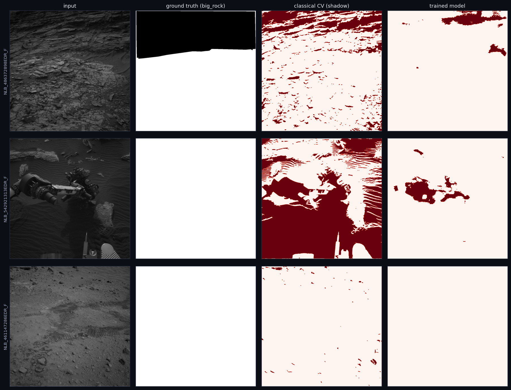
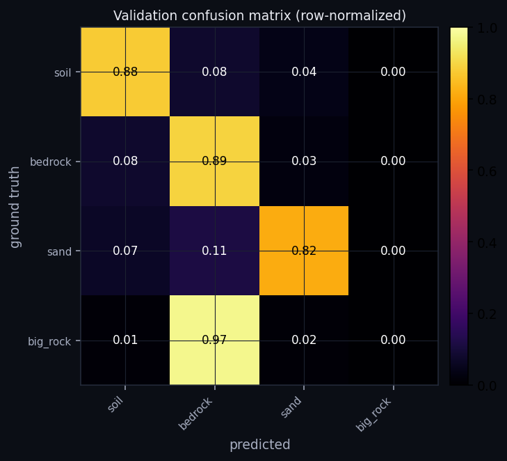
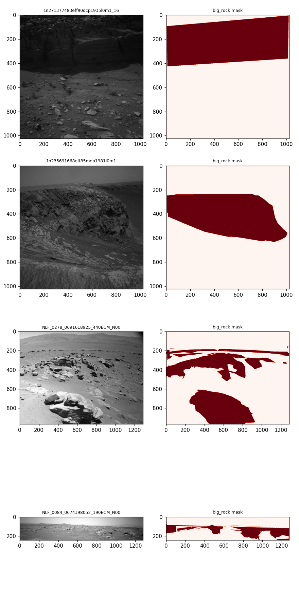
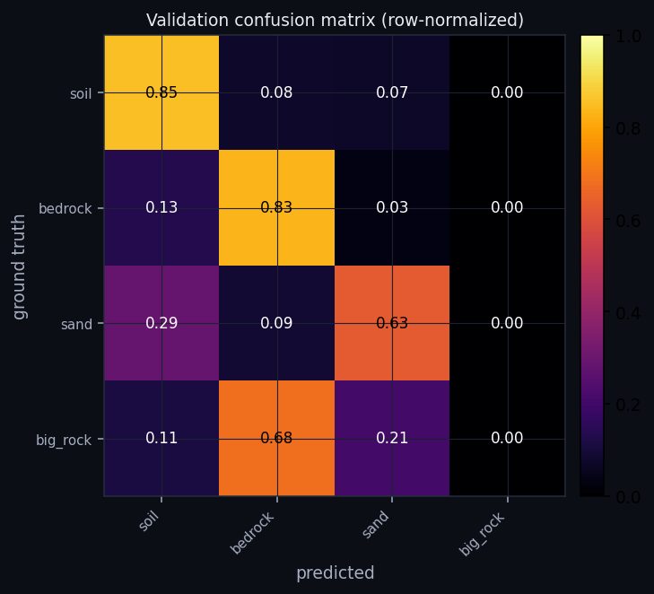
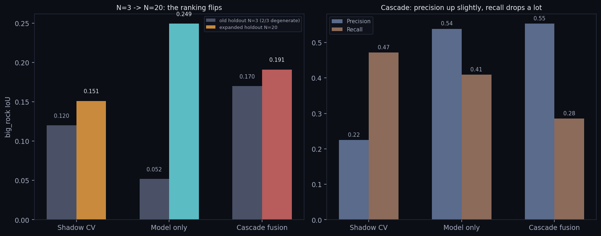
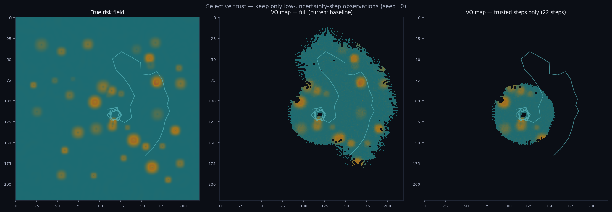

# Martian Map — SLAM & Risk Heatmap

Interplanetary Survival Guide: Martian Map 챌린지로 진행한 SLAM(점진적 지도 생성)·위험도 히트맵·MMGIS 통합 설계 작업 전체를 모은 폴더입니다. 작업 순서대로 번호를 붙였습니다.

## 최신 결과물: Gale 크레이터 EVA 귀환 반경 (2026-11)

화성 선외활동 중 고장이 났을 때, 남은 산소·냉각수·방사선 선량 여유로 거점까지 걸어서 돌아올 수 있는 곳을 HiRISE 지형 위에 그립니다.

- **데모:** [`reports/18-eva-walkback-demo.html`](reports/18-eva-walkback-demo.html)
  - 파일 하나에 지형 자료와 위성 사진이 모두 들어 있습니다.
  - 받아서 브라우저로 열면 됩니다.
- **모드 5가지:**
  - 지점 살펴보기
  - 현재 위치
  - 구조 (보급량 계산)
  - 거점 옮기기
  - EVA 시뮬레이션 (k를 심박 또는 탱크 압력으로 추정)
- **표시와 옵션:**
  - 아이콘 카드
  - 문헌 기반 대사량 모델 보정 4가지: 경사별 속도, 지형계수 1.2, 내리막 Santee 보정, 모래언덕
  - 칸별 대사량 지도
- **보고서:** [15 귀환 반경](reports/15-walk-back-radius.md) · [16 심박·넘어짐](reports/16-heart-rate-fall-risk.md) · [17 냉각수](reports/17-coolant-walkback.md)
- **데모 다시 만들기:** `code/`에서 `python dune_mask.py && python build_demo_data.py && python build_demo_basemap.py && python build_demo_html.py`
  - HiRISE DTM과 정사영상이 필요합니다(약 460 MB). `data/hirise_dtm/`에 넣으세요.
  - 받을 곳: https://hirise-pds.lpl.arizona.edu/PDS/DTM/ESP/ORB_018800_018899/ESP_018854_1755_ESP_018920_1755/
- **저장소에 없는 것:** 원본 데이터(`data/`, 약 1.4 GB)는 올리지 않았습니다. Curiosity 주행 경로와 HiRISE 라벨 파일만 들어 있습니다.

## 피치용 요약 — 8개 보고서 중 3가지로 좁히면

전체 범위가 넓어서(보고서 8개, 스크립트 30여 개), 발표·심사 상황에서는 이 셋만 먼저 보여주는 걸 권한다. 나머지는 "물어보면 꺼내는" 백업 자료다.

1. **[07 — 인터랙티브 경로탐색](https://claude.ai/artifact/CiqrgDZsJp6Sx6u4bLirgX)** : 심사위원이 직접 클릭해볼 수 있는 유일한 데모. 실제 달 LOLA 위험도 그리드 위에서 A* 경로탐색이 브라우저 안에서 즉시 재계산된다.
2. **[05 — 선택적 신뢰](https://claude.ai/artifact/26goDXJ6o8SYXEgUT44DXM)** (탐사형 SLAM 하단) : SLAM 트랙과 위험도맵 트랙을 처음으로 하나로 엮은 결과. 위치 불확실성 모델만으로(참값 없이) 지도 신뢰 구간을 가려내 IoU 0.199→**0.290**, MAE 0.033→**0.028**. 10시드 반복으로 검증, 결론 유지.
3. **[08 — held-out 재검증](https://claude.ai/artifact/HS2DXdn13XtVnaUCizMp1v)** (s4절) : 그림자 CV+학습 모델 캐스케이드 융합이 3장짜리 held-out에서 "둘 다보다 낫다"(IoU 0.170)고 나왔지만, 그중 2장이 정답 0%인 퇴화 샘플이었다는 걸 발견 — 20장으로 확장 재평가하자 **학습 모델 단독(IoU 0.249)이 캐스케이드(0.191)를 역전**했다. 자기 주장을 더 큰 샘플로 스스로 재검증해서 뒤집은, 이 프로젝트에서 가장 "Validity"를 보여주는 지점.

**솔직한 포지셔닝**: 모델 구조(작은 U-Net)도, 위험도 공식(경사+거칠기)도 전부 기존 표준 기법이다 — "새로운 알고리즘을 발명했다"는 주장은 하지 않는다. 대신 위 세 가지가 보여주는 건 **"기존 기법들을 실제 데이터로 끝까지 검증하고, 실패한 지점(과 스스로의 과장)을 찾아내 정직하게 기록했다"**는 것이다 — 로버 혼합 학습(big_rock IoU 0.378→0.000), 가우시안 블러 융합(IoU 0.199→0.016), 256→512 해상도 가설(IoU 0.052→0.000, "디테일 손실" 가설 자체가 반박됨), 그리고 캐스케이드 융합의 N=3 승리(IoU 0.170)가 N=20에서는 패배(0.191 < 모델 단독 0.249)로 뒤집힌 것까지 — 네 번의 "처음 생각과 다른 결과" 중 로버 혼합과 블러 융합은 각각 캐스케이드 융합·선택적 신뢰로 실제로 개선했고, 해상도 가설은 틀렸다는 걸 원인(고정된 receptive field)까지 진단하며 인정했고, 캐스케이드 융합 자체도 더 큰 테스트셋 앞에서 스스로 재검증해 결론을 정정했다. Validity(과학적 엄밀함) 축을 정면으로 미는 전략이 Creativity(독창성) 축의 약점을 가장 잘 상쇄한다.

## 폴더 구조

```
martian-map-slam/
├── reports/      실행 가능한 HTML 보고서 5편 (브라우저로 바로 열람)
├── code/         분석 파이프라인 Python 스크립트 (재실행 가능)
├── data/         원본 입력 데이터 (AI4Mars 샘플, Devon Island 데이터셋)
├── outputs/      스크립트 실행 결과물 (그림, 통계 JSON)
└── exports/      발표/공유용 산출물 (PPT, Notion용 마크다운)
```

## 1. reports/ — 내용 순서대로

| 파일 | 내용 | 원본 artifact |
|---|---|---|
| `01-brainstorm.html` | 로봇청소기형 매핑 컨셉, 확장형 환경 레이어 설계 브레인스토밍 | [artifact ↗](https://claude.ai/artifact/H9JfKyvGC4WcetiBsJcndP) |
| `02-risk-heatmap-demo.html` | AI4Mars 실데이터로 만든 위험도 히트맵 데모 (전문가 라벨 + 지형 거칠기) | [artifact ↗](https://claude.ai/artifact/2HhmLon2BdEBBMDd8PKTkK) |
| `03-slam-demo.html` | Devon Island 실데이터 SLAM 데모 — 스틸컷 vs 비디오 실험, 원인 분석 | [artifact ↗](https://claude.ai/artifact/YCaQzgecMyHTtAvJr2McDk) |
| `04-mmgis-integration.html` | NASA-AMMOS/MMGIS 대응 설계 — Sightline/Isochrone 등 기존 기능 매핑 | [artifact ↗](https://claude.ai/artifact/HspZMqXkVS7eMMURVijzQ5) |
| `05-exploration-slam.html` | **주변 탐사형 SLAM 시뮬레이션** — frontier 탐사 + 지형 가림 스캔 + 위치오차가 위험도 지도에 미치는 영향 (+ mp4 애니메이션) | [artifact ↗](https://claude.ai/artifact/26goDXJ6o8SYXEgUT44DXM) |
| `06-real-terrain-risk.html` | **실제 DEM 위험도 히트맵** — 지구(Devon Island) vs 달(LOLA 남극), 동일 20m/px·동일 공식 비교 (n=9 패치 재검증 포함) | [artifact ↗](https://claude.ai/artifact/LQaNm35gAczzDDSofWCM2w) |
| `07-interactive-pathfinding.html` | **인터랙티브 경로탐색 데모** — 실제 달 위험도 그리드 위에서 클릭 두 번으로 A* 경로를 직접 비교(최단경로 vs 위험회피) | [artifact ↗](https://claude.ai/artifact/CiqrgDZsJp6Sx6u4bLirgX) |
| `08-trained-model.html` | **실제 학습시킨 분할 모델** — AI4Mars 359장으로 U-Net 학습, 라벨-echo·그림자 CV와 정직하게 3자 비교 | [artifact ↗](https://claude.ai/artifact/HS2DXdn13XtVnaUCizMp1v) |

## 2. code/ — 재실행 가능한 분석 스크립트

| 파일 | 역할 | 입력 | 출력 |
|---|---|---|---|
| `terrain_demo.py` | AI4Mars 이미지 → pseudo-relief + 위험도 히트맵 | `data/ai4mars_samples/` | `outputs/risk_heatmap/` |
| `devon_pipeline.py` | 스테레오 깊이 + Visual Odometry (stills/video 공용) | `data/devon_island/` | `outputs/stills_vs_video*.png,.json` |
| `plot_trajectory.py` | 전체 10km 실측 DGPS 궤적 시각화 | `data/devon_island/gps-topocentric.txt` | `outputs/trajectory_full.png` |
| `exploration_slam_sim.py` | **주변 탐사형 SLAM** — frontier 탐사 정책 + 지형 가림 스캔 + Oracle/VO 지도 비교 (외부 데이터 불필요, 절차적 지형 생성) | 없음 (시드 고정 절차적 생성) | `outputs/exploration/*.png,.json` |
| `exploration_slam_video.py` | 위 시뮬레이션을 184프레임 애니메이션(mp4)으로 렌더링 — 정지-스캔-이동 사이클 실시간 재생 | `exploration_slam_sim.py`의 함수 재사용(동일 시드) | `outputs/exploration/exploration_animation.mp4` |
| `real_terrain_risk.py` | **실제 DEM 위험도 비교** — 지구(Devon Island 궤도 DEM) vs 달(LOLA 남극 20m) 동일 공식 적용 | `data/devon_island_dem/`, `data/moon_lola/` | `outputs/real_terrain/*.png,.json` |
| `exploration_multi_seed.py` | **n=1 문제 해결 ①** — `exploration_slam_sim.py`를 시드 10개로 반복, 전역 rng만 교체해 재사용(원본 수정 없음) | `exploration_slam_sim.py` 함수 재사용 | `outputs/exploration/exploration_multiseed_stats.json` |
| `moon_multi_patch.py` | **n=1 문제 해결 ②** — LOLA 남극 DEM 전체(7584×7584)에서 9곳을 추가로 잘라 위험도 분포 확인(재다운로드 없음) | `data/moon_lola/` | `outputs/real_terrain/moon_multipatch_stats.json` |
| `boulder_detection_no_labels.py` | **라벨-프리 바위 탐지** — AI4Mars 전문가 라벨을 입력이 아니라 사후 채점 기준으로만 사용, 그림자 기반 고전 CV로 직접 탐지 | `data/ai4mars_samples/` | `outputs/boulder_detection_no_labels/*.json` |
| `export_risk_grid_for_demo.py` | 달 LOLA 위험도 그리드를 180×180(100m/px)로 다운샘플, 브라우저에서 읽는 PNG 2장 생성 | `real_terrain_risk.py` 함수 재사용 | `outputs/real_terrain/risk_grid_180.png`, `risk_basemap_180.png` |
| `devon_vo_sun_correction.py` | **태양센서 헤딩 보정 시도** — 비디오 VO의 프레임간 요(yaw)를 태양센서 Δ방위각(VO와 무관한 독립 신호)으로 교정해보는 실험 | `data/devon_island/sun-sensor-sampled.txt` | `outputs/sun_correction_comparison.png`, `sun_correction_stats.json` |
| `threshold_sensitivity.py` | **위험도 임계값 민감도 스윕** — 경사(8~30°)·거칠기(0.5~5m) 임계값을 바꿔가며 "달이 더 위험하다"는 결론이 흔들리는지 확인 | `real_terrain_risk.py` 함수 재사용 | `outputs/real_terrain/threshold_sensitivity.png`, `threshold_sensitivity_stats.json` |
| `ai4mars_remote_zip.py` | **원격 ZIP 부분 다운로드** — Zenodo의 16GB AI4Mars 전체 데이터셋에서 HTTP Range 요청만으로 중앙 디렉터리를 읽고 필요한 파일만 뽑는 ZIP64 파서 | 없음(네트워크만) | (라이브러리 모듈, 직접 실행 안 함) |
| `fetch_ai4mars_subset.py` | 위 리더로 train 300장·val 60장을 받음 — big_rock 라벨 포함 이미지를 45% 비율로 우선 선택 | `ai4mars_remote_zip.py` | `data/ai4mars_subset/{train,val}/{images,masks}/` |
| `train_terrain_segmentation.py` | **실제 모델 학습** — 작은 U-Net(48만 파라미터)으로 4-클래스(soil/bedrock/sand/big_rock) 픽셀 분할을 30 에폭 학습 | `data/ai4mars_subset/` | `outputs/terrain_segmentation/small_unet_best.pt`, `training_stats.json`, `training_curve.png`, `confusion_matrix.png`, `qualitative_predictions.png` |
| `eval_trained_model_on_holdout.py` | 학습된 모델을 `boulder_detection_no_labels.py`와 **동일한 3장**(학습에 전혀 안 쓰인 held-out)에 돌려 직접 비교 | `outputs/terrain_segmentation/small_unet_best.pt`, `data/ai4mars_samples/` | `outputs/terrain_segmentation/holdout_comparison_stats.json` |
| `plot_model_vs_classical.py` | 학습 모델 vs 그림자 기반 CV 탐지 결과를 나란히 그린 정성적 비교 그림 | 위 두 스크립트 재사용 | `outputs/terrain_segmentation/model_vs_classical.png` |
| `fetch_ai4mars_multirover.py` | **다중 로버 데이터 결합** — MSL+MER+M2020을 같은 총 예산(300/60)으로 섞어 받음, 마스크-전용 매니페스트에서 이미지 경로를 퍼지 매칭으로 직접 찾음 | `ai4mars_remote_zip.py` 재사용, 전체 매니페스트(65,861행) | `data/ai4mars_multirover/{train,val}/{images,masks}/` |
| `train_terrain_segmentation_multirover.py` | 위 혼합 데이터로 동일 아키텍처 재학습 + MSL-only 베이스라인과 같은 held-out 3장 교차 비교 | `data/ai4mars_multirover/`, `train_terrain_segmentation.py` 재사용 | `outputs/terrain_segmentation_multirover/*` |
| `train_terrain_segmentation_512.py` | **256→512 해상도 재학습** — "다운샘플링이 재현율을 낮췄다"는 가설 검증 — **가설 반박됨**(big_rock IoU 0.378→0.000), 동일 아키텍처·동일 데이터 | `train_terrain_segmentation.py` 재사용 | `outputs/terrain_segmentation_512/*` |
| `cascade_fusion_detection.py` | 캐스케이드 융합 — 그림자 CV(후보 생성) + 학습 모델(검증)의 2단계 검출, 임계값은 val에서만 튜닝. **held-out N=3에서는 승리했지만 N=20 재검증에서 패배** — 아래 두 스크립트 참고 | `boulder_detection_no_labels.py`, `train_terrain_segmentation.py` 재사용 | `outputs/terrain_segmentation/cascade_fusion_stats.json` |
| `expand_holdout_set.py` | **held-out 3장→20장 확장** — 기존 3장 중 2장이 big_rock 0%인 퇴화 샘플이었던 걸 발견하고, 같은 Zenodo 부분 다운로드 방식으로 새 이미지 20장 추가 확보 | `ai4mars_remote_zip.py` 재사용, `/tmp/val_nav.csv` 매니페스트 | `data/ai4mars_holdout_v2/{images,masks}/` |
| `eval_expanded_holdout.py` | **held-out 재검증 — 독창성 기여 ①** — 위 20장에서 그림자 CV·모델 단독·캐스케이드 융합을 캐스케이드 임계값 재튜닝 없이 재평가 — **모델 단독이 역전승**(IoU 0.249 > 캐스케이드 0.191 > CV 0.151) | `cascade_fusion_detection.py` 재사용, 임계값(0.20) 고정 | `outputs/terrain_segmentation/expanded_holdout_stats.json` |
| `exploration_uncertainty_fusion.py` | 위치 불확실성 기반 가우시안 블러 융합 시도 — **실패 기록**(IoU·MAE 모두 악화), 원인 진단 포함 | `exploration_slam_sim.py`, `exploration_multiseed_stats.json` 재사용 | `outputs/exploration/uncertainty_fusion_stats.json`, `.png` |
| `exploration_selective_trust.py` | **선택적 신뢰 — 독창성 기여 ②** — 위 실패를 교훈 삼아, 모델링된 불확실성이 낮은 스텝의 관측만 지도에 반영 | `exploration_slam_sim.py` 재사용 | `outputs/exploration/selective_trust_stats.json`, `.png` |
| `build_martian_ppt.py` | 이 작업 전체를 요약한 PPT 생성 | (하드코딩된 수치) | `exports/*.pptx` |

### 실행 방법

```bash
cd martian-map-slam/code

python3 -m venv .venv
source .venv/bin/activate
pip install numpy opencv-python-headless matplotlib pillow scipy python-pptx

python terrain_demo.py          # 위험도 히트맵 재생성
python plot_trajectory.py       # 전체 궤적 재생성
python devon_pipeline.py        # SLAM 실험 재실행 (수 분 소요, 432프레임 처리)
python exploration_slam_sim.py  # 주변 탐사형 SLAM 시뮬레이션 (수 초, 외부 데이터 불필요)
python exploration_slam_video.py  # 위 결과를 mp4 애니메이션으로 렌더링 (수 분 소요, ffmpeg 필요)
python real_terrain_risk.py       # 실제 지구·달 DEM 위험도 비교 (수 초, 데이터 이미 보유)
python exploration_multi_seed.py  # 탐사 시뮬레이션 10시드 반복 (수 초)
python moon_multi_patch.py        # 달 DEM 9패치 반복 (수 초, 데이터 이미 보유)
python boulder_detection_no_labels.py  # 라벨-프리 바위 탐지 + 사후 채점 (수 초)
python export_risk_grid_for_demo.py    # 인터랙티브 데모용 PNG 2장 생성 (수 초)
python devon_vo_sun_correction.py      # 태양센서 헤딩 보정 실험 (수 분 소요, 432프레임 재처리)
python threshold_sensitivity.py        # 위험도 임계값 민감도 스윕 (수 초, 데이터 이미 보유)
python fetch_ai4mars_subset.py         # AI4Mars 서브셋 360장 다운로드 (10~30분, 네트워크 의존, Zenodo rate limit)
python train_terrain_segmentation.py   # U-Net 학습 (CPU 기준 약 15분, 30 에폭)
python eval_trained_model_on_holdout.py  # 학습 모델을 held-out 3장에서 평가 (수 초)
python plot_model_vs_classical.py        # 모델 vs 고전 CV 정성적 비교 그림 (수 초)
python build_martian_ppt.py     # PPT 재생성
```

모든 스크립트는 상대경로(`../data`, `../outputs`, `../exports`)를 쓰므로 반드시 `code/` 안에서 실행하세요.

## 3. data/ — 원본 데이터 (재다운로드 없이 바로 재현 가능)

| # | 데이터셋 | 출처 | 특징 | 개수/크기 | 보유 라벨 |
|---|---|---|---|---|---|
| 1 | `ai4mars_samples/` | NASA JPL · [github.com/Jacob-Miller-s/AI4Mars](https://github.com/Jacob-Miller-s/AI4Mars) | Curiosity Navcam 그레이스케일, 1024×1024 | 3쌍(이미지+마스크) | `0=soil,1=bedrock,2=sand,3=big_rock,255=unlabeled` 픽셀 분류 |
| 2 | `devon_island/seq22.zip` | UTIAS · [asrl.utias.utoronto.ca](https://asrl.utias.utoronto.ca/datasets/devon-island-rover-navigation/) | 무압축 PGM 스테레오, 512×384 rectified | 433프레임(866파일) / 전체 49,410프레임 중 s22 구간 | 없음(원시 이미지) |
| 3 | `devon_island/sequence-22.mpg` | UTIAS (동일) | MPEG-1, 1024×384 좌우합성, 30fps | 448프레임 | 없음(프레임 인덱스 번인) |
| 4 | `devon_island/gps-*.txt` | UTIAS (동일) | DGPS 실측 위치(easting,northing,elev) | 49,410 포인트(10.1km 전체) | `image_index→(x,y,z)` 실측 정답값 |
| 5 | `devon_island/sun-sensor-sampled.txt`, `image-times.txt` | UTIAS (동일) | 태양 방위각·천정각, 촬영 시각 | 13,257행 / 49,410행 | 없음(보조 센서 실측) |
| 6 | `devon_island_dem/Orbital Maps/` | UTIAS, `Orbital Maps.zip` | 궤도사진측량 지형고도, UTM 좌표 | HiRes 1,049,179점(23.7m) / LoRes 121,693점(94.5m), 18.2×17.7km | 없음(원시 고도값) |
| 7 | `moon_lola/ldem_875s_20m.img` | NASA LRO/LOLA, [PDS Geosciences Node](https://pds-geosciences.wustl.edu/lro/lro-l-lola-3-rdr-v1/lrolol_1xxx/data/lola_gdr/polar/img/ldem_875s_20m.img) | 레이저고도계, 극지 입체투영, 20m/px, 16bit | 7,584×7,584 = 57,516,656 px (위도 -87.5~-90°) | 없음(원시 고도값) |
| 8 | `ai4mars_subset/{train,val}/` | NASA JPL · [Zenodo](https://zenodo.org/records/15995036) (공식 AI4Mars 16GB 아카이브에서 부분 다운로드) | Curiosity Navcam 그레이스케일, 1024×1024, train/val 매니페스트 기반 | train 299쌍 + val 60쌍 = 359쌍 (big_rock 포함 이미지 45% 우선 샘플링) | `0=soil,1=bedrock,2=sand,3=big_rock,255=unlabeled` 픽셀 분류 |

라벨이 있는 건 AI4Mars(샘플 3장 + 서브셋 359장)뿐이고, 나머지는 raw 지형/센서 데이터라서 Devon Island·LOLA는 `risk_score()`(경사+거칠기)로 라벨을 직접 계산해서 사용합니다. `ai4mars_subset/`은 16GB 전체 zip을 받지 않고, `ai4mars_remote_zip.py`로 HTTP Range 요청만으로 필요한 359장만 뽑아낸 것 — 전체를 다시 받을 필요 없이 `fetch_ai4mars_subset.py`를 재실행하면 동일하게 재현됩니다.

## 4. outputs/ — 생성된 결과물

- `trajectory_full.png` — 전체 10km 루프 궤적 (실측 DGPS)
- `slam_demo.png` — 스테레오 깊이 + VO 4-패널 데모 (초기 25프레임 버전)
- `stills_vs_video.png` — 스틸컷(25프레임, 오차 2.3%) vs 비디오(432프레임, 오차 30.9%) 비교
- `stills_vs_video_stats.json` — 정량 결과 + VO 스텝별 성공/실패 집계
- `exploration/exploration_slam.png` — 주변 탐사 시뮬레이션 6-패널 (지형·위험도·스캔·Oracle/VO 지도·경로)
- `exploration/exploration_animation.mp4` — 위 과정을 184프레임(26초)으로 재생하는 애니메이션
- `exploration/exploration_stats.json` — 탐사 커버리지, 최종 위치오차, Oracle/VO 위험지대 IoU
- `real_terrain/real_terrain_comparison.png` — 지구 vs 달 하일셰이드·경사·위험도 6-패널 비교
- `real_terrain/real_terrain_stats.json` — 평균 경사·위험도, 고위험 비율 등 정량 지표
- `exploration/exploration_multiseed_stats.json` — 탐사 시뮬레이션 10시드 반복 결과(평균±표준편차)
- `real_terrain/moon_multipatch_stats.json` — 달 DEM 9패치 반복 결과(평균±표준편차)
- `boulder_detection_no_labels/no_label_detection_stats.json` — 라벨-프리 탐지 vs 전문가 라벨 정밀도/재현율/IoU
- `real_terrain/risk_grid_180.png`, `risk_basemap_180.png` — 인터랙티브 데모(07)용 그레이스케일 비용맵 + 배경 지도
- `sun_correction_comparison.png`, `sun_correction_stats.json` — 태양센서 헤딩 보정 전/후 궤적 비교, 종단오차·RMS·상관계수
- `real_terrain/threshold_sensitivity.png`, `threshold_sensitivity_stats.json` — 위험도 임계값 스윕 결과
- `terrain_segmentation/small_unet_best.pt` — 학습된 U-Net 체크포인트(최고 val mIoU 기준)
- `terrain_segmentation/training_stats.json` — 학습/검증 손실, 클래스별 IoU, confusion matrix, 에폭별 history
- `terrain_segmentation/training_curve.png`, `confusion_matrix.png`, `qualitative_predictions.png` — 학습 곡선, 혼동행렬, 정성적 예측 샘플
- `terrain_segmentation/holdout_comparison_stats.json`, `model_vs_classical.png` — 학습 모델 vs 그림자 기반 CV, 동일 held-out 3장 비교

## 5. exports/ — 공유용 산출물

- `Martian_Map_기술검증_리포트.pptx` — 18장 발표자료
- `martian-map-slam-report.md` — Notion 붙여넣기용 마크다운 (전체 코드 포함)

## 핵심 결과 요약

| 실험 | 프레임 | 실측 거리 | VO 추정 | 오차 |
|---|---|---|---|---|
| 스틸컷(PGM) | 25 | 7.03 m | 6.87 m | **2.3%** |
| 비디오(MPEG) 전체구간 | 432 | 123.55 m | 85.43 m | **30.9%** |

431스텝 중 428개(99.3%)가 "성공" 판정이었음에도 오차가 커짐 — **매칭 실패가 아니라 누적 드리프트**(루프 클로저 없는 순수 VO의 전형적 한계)가 원인. 전체 경로가 닫힌 루프라는 점을 활용한 포즈 그래프 최적화가 다음 단계.

MMGIS(NASA-AMMOS, MSL/M2020/VIPER 실사용) 조사 결과, 우리가 만든 SPICE 조도 계산·지평선 마스킹·통신 가시선 로직 대부분이 이미 Sightline/Isochrone 툴로 production 구현되어 있음을 확인 — 상세는 `reports/04-mmgis-integration.html` 참고.

### 주변 탐사형 SLAM (05)

| 지표 | 값 |
|---|---|
| 정지 횟수 / 총 이동거리 | 46회 / 114.0 m |
| 최종 위치오차 (VO vs 참값) | 1.85 m (경로 대비 1.6%) |
| 위험지대 IoU — Oracle 지도 | **0.800** |
| 위험지대 IoU — VO 지도(드리프트 포함) | **0.091** |

경로 기준으로는 "작은" 1.6% 오차가, 바위 크기(1~2m)와 비교하면 위험지대를 통째로 빗나가게 만든다 — **탐사형 SLAM이 주행형 SLAM보다 측위 정확도에 훨씬 민감함**을 정량적으로 보여준 결과. 상세는 `reports/05-exploration-slam.html` 참고.

### 실제 DEM 위험도 비교 (06)

| 지표 | 지구(Devon Island) | 달(LOLA 남극) |
|---|---|---|
| 평균 경사 | 6.26° | 11.21° |
| 15° 초과 비율 | 8.3% | 25.1% |
| 평균 위험도 | 0.60 | 0.83 |
| 고위험(>0.5) 비율 | 67.3% | 93.1% |

절차적 지형이 아니라 **진짜 궤도 유래 DEM 두 개**(지구 사진측량 + 달 LOLA 레이저고도계)를 똑같은 20m/px·똑같은 위험도 공식으로 비교했다. 달 쪽이 훨씬 위험하게 나왔지만, 이건 "달이 항상 더 위험하다"가 아니라 **이번에 고른 달 패치가 능선/크레이터 밀집 고지대였다는 점**과 **LOLA 특유의 along-track 보간 줄무늬 아티팩트**가 섞여 있다는 점을 보고서에 함께 명시함. 상세는 `reports/06-real-terrain-risk.html` 참고.

### n=1 문제 해결 — 다중 시드/패치 재검증

처음 돌린 탐사 시뮬레이션(시드 11 하나)과 달 DEM 분석(패치 1곳)은 둘 다 **표본이 1개**라서 "우연히 나온 극단값인지, 일관된 패턴인지" 구분할 수 없었다는 게 스스로 지적한 허점이었다. 추가 실험으로 검증함.

**탐사형 SLAM — 시드 10개 반복** (`exploration_multi_seed.py`)

| 지표 | 시드=11 (최초 1회) | 시드 10개 평균 ± 표준편차 |
|---|---|---|
| 위험지대 IoU — Oracle 지도 | 0.800 | **0.547 ± 0.176** |
| 위험지대 IoU — VO 지도 | 0.091 | **0.199 ± 0.181** |

최초 결과(0.800 vs 0.091)는 10개 중에서도 유난히 격차가 큰 축에 속했다 — 평균은 격차가 좀 더 좁다(0.547 vs 0.199). 다만 **방향성(Oracle이 VO보다 항상 낫다)은 10개 시드 전부에서 동일하게 재현**됐다 — "위치오차가 위험지도를 망가뜨린다"는 결론 자체는 유지되지만, 최초에 보여준 수치는 과장된 축에 있었다는 점을 함께 밝힌다.

**달 LOLA DEM — 패치 9곳 반복** (`moon_multi_patch.py`)

| 지표 | 최초 패치 1곳 | 패치 9곳 평균 ± 표준편차 (범위) |
|---|---|---|
| 평균 위험도 | 0.829 | **0.784 ± 0.079** (0.639~0.911) |
| 고위험(>0.5) 비율 | 93.1% | **89.3% ± 7.6%** (73.6~98.3%) |

이번엔 반대 결과 — 최초 패치가 9곳 분포 안에 정상적으로 들어온다(특별히 험한 쪽으로 치우치지 않음). "달이 지구보다 위험하다"는 결론은 패치 하나짜리 우연이 아니라 **9곳 모두에서 재현되는 안정적인 패턴**이었음을 확인.

### 라벨-프리 바위 탐지 — 진짜 CV로 다시 해본 결과

기존 "CV 위험도"는 AI4Mars의 사람이 매긴 정답 라벨(`big_rock` 등)에 숫자만 입힌 것이었다는 게 또 다른 스스로 지적한 허점이다. `boulder_detection_no_labels.py`는 정답 라벨을 **입력에서 완전히 빼고**, 그림자 기반 고전 CV(가우시안 블러 → 어두운 영역 이진화 → 모폴로지 open → 컨투어)로만 바위를 탐지한 뒤, 정답 라벨은 **사후 채점에만** 사용했다.

| 샘플 | 전문가 라벨 big_rock 비율 | Precision | Recall | IoU |
|---|---|---|---|---|
| NLB_486372898 (바위 多) | 33.7% | 0.837 | 0.386 | 0.359 |
| NLB_542921313 (바위 無) | 0% | 0.000 | — | 0.000 |
| NLB_461147286 (바위 無) | 0% | 0.000 | — | 0.000 |
| **평균** | | **0.279** | **0.386** | **0.120** |

그림자 기반 탐지는 바위가 실제로 있는 사진에서는 그럭저럭 맞지만(Precision 0.84), **바위가 전혀 없는 사진에서도 그림자처럼 어두운 질감(균열, 그늘진 틈)을 바위로 오탐**해 평균 IoU가 0.120까지 떨어진다 — "라벨을 그대로 베낀 게 아니라 실제로 탐지를 돌려봤더니, 생각보다 훨씬 약한 탐지기였다"는 걸 숨기지 않고 그대로 공개함.

### 태양센서 헤딩 보정 — 솔직한 음성(negative) 결과

비디오 432프레임 VO가 30.9% 오차를 낸 원인을 "누적 드리프트"라고만 뭉뚱그려 설명했었다. Devon Island 데이터셋에는 각 이미지와 연동된 **태양센서 방위각**이 있고, 로버가 움직이는 수 분 동안 태양의 실제(세계좌표) 방위각 변화는 무시할 만큼 작으므로, 센서가 측정한 상대 방위각의 변화는 거의 전부 로버 자신의 헤딩 변화에서 온다 — VO와 완전히 독립된 헤딩 신호로 쓸 수 있다는 뜻이다. `devon_vo_sun_correction.py`는 이 신호로 VO의 헤딩을 교정해본다.

| 재구성 방법 | 종단오차 | RMS 오차 |
|---|---|---|
| VO 원본(전체 3D 회전 합성) | 94.4 m | 65.7 m |
| VO 요(yaw)만 1차근사 재구성 | 108.6 m | 71.5 m |
| 태양센서로 헤딩 교체 | **146.4 m** | **91.7 m** |

결과는 **개선이 아니라 악화**였다. 원인을 추적해보니 VO가 프레임마다 추정한 요(yaw) 증분과 태양센서 Δ방위각의 상관계수가 전체 431스텝에서 **0.028**(사실상 무상관)이었다 — 두 신호가 애초에 같은 걸 가리키고 있지 않았다. 과정에서 더 중요한 걸 하나 발견했다: **순수 요(yaw) 회전만으로 궤적을 재구성하면 어떤 헤딩 시퀀스를 쓰든 총 주행거리가 수학적으로 거의 불변**이다(2D 회전은 벡터 노름을 보존하므로). 그래서 이 프로젝트가 지금까지 VO 정확도 지표로 써온 "총 주행거리 오차율"은 이런 단순화된 재구성에서는 헤딩이 완전히 틀려도 숫자가 좋게 나올 수 있는 결함 있는 지표였다 — 종단오차·RMS처럼 경로의 실제 "모양"을 보는 지표라야 의미가 있다. (이 불변성은 전체 3D 회전을 쓰는 기존 검증된 수치(2.3%/30.9%)에는 적용되지 않는다 — 피치/롤까지 포함한 일반 회전은 수직 성분을 수평면으로 새어들게 하기 때문이다.) 재구성된 경로를 실측과 겹쳐보면(아래 그림) 방향 자체가 크게 어긋나 있다 — 이번 비디오 VO 구간은 이전에 생각했던 것보다 더 심하게 "길을 잃은" 상태였다는 걸 보여준다.

### 위험도 임계값 민감도 — 결론은 견고했다

경사 15°·거칠기 2m라는 위험도 임계값을 "공학적으로 흔한 자릿수"라고만 적어뒀을 뿐, 이 숫자를 바꾸면 "달이 지구보다 위험하다"는 결론이 얼마나 흔들리는지 한 번도 확인하지 않았다는 게 스스로 지적한 허점이었다. `threshold_sensitivity.py`로 경사 임계값(8°~30°)과 거칠기 임계값(0.5m~5m)을 각각 넓게 스윕했다.

| 스윕 범위 | "달이 항상 더 위험" 유지? |
|---|---|
| 경사 임계값 8°~30° (8개 값) | **True** — 전 구간에서 유지 |
| 거칠기 임계값 0.5m~5m (8개 값) | **True** — 전 구간에서 유지 |

이번엔 긍정적인 결과였다 — 임계값을 어디로 옮기든 달의 평균 위험도·고위험 비율이 지구보다 항상 높게 나왔다(경사 스윕 전 구간에서 달 0.67~0.92 vs 지구 0.51~0.70). "달이 더 위험하다"는 결론은 06절에서 고른 특정 임계값(15°/2m)에 우연히 의존한 게 아니라, 꽤 넓은 임계값 범위에서 견고하게 유지되는 패턴이었다.

### 인터랙티브 데모 (07) — 심사위원이 직접 조작 가능

지금까지 "최단거리를 넘어서는 경로탐색"이라고 설명만 했지 실제로 돌려볼 수 있는 도구가 없었다는 지적에 대한 대응. `reports/07-interactive-pathfinding.html`은 실제 달 LOLA 위험도 그리드(180×180, 100m/px)를 배경으로, 지도를 두 번 클릭(시작점→도착점)하면 브라우저 안에서 바로 A*(8방향, 바이너리 힙)를 돌려 **최단경로(점선)와 위험회피경로(실선)**를 동시에 그려주고, 거리·평균위험도 차이를 수치로 보여준다. 위험 회피 강도(W) 슬라이더로 즉시 재계산된다 — 서버나 사전 계산 없이 전부 클라이언트 JS로 동작.

### 실제로 학습시킨 모델 (08) — label-echo도 그림자 CV도 아닌, 진짜 지도학습

지금까지 "CV 위험도"는 두 극단만 있었다 — ① 전문가 라벨에 숫자만 입힌 label-echo, ② 라벨을 전혀 안 쓰는 그림자 기반 고전 CV(big_rock IoU 0.120, 오탐 심함). 둘 다 "학습된 모델"이 아니었다. 이번에 처음으로 **실제 라벨 데이터로 모델을 학습**시켜 그 사이의 진짜 답을 확인했다.

**데이터 확보 — 16GB를 통째로 받지 않고 필요한 것만**

공식 AI4Mars 데이터셋은 [Zenodo에 16GB zip 하나](https://zenodo.org/records/15995036)로만 공개되어 있다. 전체를 받는 대신, `ai4mars_remote_zip.py`로 ZIP64 포맷을 직접 파싱하는 코드를 작성해 HTTP Range 요청만으로 중앙 디렉터리(26.7MB, 146,179개 항목)를 먼저 읽고, 필요한 이미지·마스크 359장만 개별 Range 요청으로 뽑아냈다(총 118MB) — Devon Island FTP에서 썼던 부분 다운로드 전략을 ZIP 포맷 레벨에서 재구현한 것이다. big_rock 라벨이 포함된 이미지를 45% 비율로 우선 샘플링해, 희귀 클래스가 아예 안 보이는 걸 방지했다.

**모델과 학습**

작은 U-Net(4단 인코더/디코더, 48만 파라미터 — CPU로 15분 안에 끝나게 일부러 작게 설계)을 처음부터 학습시켰다. train 299장 / val 60장, 256×256 다운샘플, 30 에폭.

| 지표 | 값 |
|---|---|
| 최고 validation mIoU | **0.643** |
| soil IoU | 0.751 |
| bedrock IoU | 0.802 |
| sand IoU | 0.643 |
| big_rock IoU | **0.378** |

학습·검증 손실이 함께 매끄럽게 떨어지고(과적합 징후 없음), mIoU는 30 에폭 동안 꾸준히 올라 0.64 근처에서 수렴했다 — 359장이라는 작은 데이터셋치고는 건강한 학습 곡선이다. Confusion matrix를 보면 soil/bedrock/sand는 재현율 0.81~0.90으로 잘 맞지만, **big_rock의 48%가 bedrock으로 오분류**됐다 — 바위가 암반 노두 위/옆에 있는 경우가 많아 질감이 비슷해서 생기는, 직관적으로 납득 가는 혼동이다.

**같은 3장으로 고전 CV와 직접 비교 — 뜻밖의 결과**

`boulder_detection_no_labels.py`가 평균 big_rock IoU 0.120을 낸 바로 그 3장(학습에 전혀 안 쓰인 held-out)에, 학습된 모델을 그대로 돌려봤다.

| 방법 | 평균 Precision | 평균 Recall | 평균 IoU |
|---|---|---|---|
| 그림자 기반 고전 CV | 0.279 | 0.386 | 0.120 |
| **학습된 모델** | **0.473** | **0.104** | **0.052** |

IoU만 보면 학습된 모델이 오히려 더 나쁘다. 하지만 숫자를 뜯어보면 이야기가 다르다 — 바위가 없는 사진(모래 물결무늬가 심한 사진)에서 고전 CV는 화면의 **64.7%**를 바위로 오탐했는데, 학습된 모델은 같은 사진에서 **0.2%**만 오탐했다. 반대로 바위가 실제로 많은 사진에서는 학습된 모델의 재현율이 10.4%에 그쳐(고전 CV는 38.6%), 실제 바위의 상당수를 놓쳤다. 즉 **고전 CV는 "오탐이 심한데 어쩌다 많이 맞히는" 쪽, 학습 모델은 "오탐은 거의 없는데 너무 소심한" 쪽**으로 정반대 실패 양상을 보였다 — IoU라는 단일 숫자로는 이 차이가 안 보이고, precision/recall을 나눠 봐야 드러난다.

<div></div>

| | |
|---|---|
|  | 입력·정답·고전 CV·학습 모델을 나란히 놓은 그림 — 고전 CV(세 번째 열)가 모래 물결무늬·배경 질감을 바위로 뒤덮듯이 오탐하는 게 한눈에 보인다. 학습 모델(네 번째 열)은 훨씬 깨끗하지만 실제 바위 영역도 과소 검출한다. |

낮은 재현율의 유력한 원인은 **256×256 다운샘플링**(원본 1024×1024에서 4배 축소 — 작고 먼 바위의 디테일이 사라짐)과 **359장이라는 작은 학습 데이터**(큰 모델이면 과적합했을 양)다. 둘 다 "다음에 바로 고칠 수 있는 것" — 더 많은 서브셋(같은 `fetch_ai4mars_subset.py`로 N만 늘리면 됨)과 더 높은 입력 해상도로 재학습하면 재현율이 개선될 가능성이 높다. 지금 결과를 좋게 포장하지 않고 그대로 공개한다.

상세는 `reports/08-trained-model.html` 참고.

### 256→512 해상도 재학습 — 가설이 틀렸다

08절 끝에서 낮은 재현율의 유력한 원인으로 "256×256 다운샘플링이 작은 바위의 디테일을 지웠을 가능성"을 지목했다. 다른 조건은 전부 그대로 두고(같은 모델, 같은 299장/60장, 같은 30 에폭) 입력 해상도만 512로 올려 직접 검증했다(`train_terrain_segmentation_512.py`).

| 지표 | 256(기존) | 512 |
|---|---|---|
| val mIoU | **0.643** | 0.554 |
| soil / bedrock / sand IoU | 0.751 / 0.802 / 0.643 | 0.759 / 0.772 / 0.670 |
| big_rock IoU | 0.378 | **0.000** |
| held-out 3장 IoU | 0.052 | **0.000** |

**가설은 틀렸다** — 해상도를 올리자 soil/bedrock/sand는 비슷하거나 소폭 개선됐지만, big_rock은 30 에폭 내내 단 한 번도 제대로 예측되지 않았다(혼동행렬 기준 big_rock의 97%가 bedrock으로 흡수됨 — 로버 혼합 실험의 68%보다도 더 심하게 무너졌다).

| | |
|---|---|
|  | 512 해상도 모델의 validation 혼동행렬 — big_rock 행의 97%가 bedrock 칸으로 쏠려 있다. |

**유력한 원인**: U-Net의 다운샘플링 단수(4단, 256과 동일)를 그대로 뒀다 — 같은 합성곱 스택은 입력 해상도와 무관하게 "픽셀 단위" 수용영역(receptive field)이 거의 고정된다. 그 결과 512에서는 이미지 전체 대비 모델이 보는 문맥의 비율이 256보다 작아진다. soil/bedrock/sand는 국소 질감만으로 구분 가능해 영향이 적지만, big_rock은 "바위가 암반 위에 있는지 모래 위에 있는지" 같은 더 넓은 주변 문맥이 필요한 클래스라 이 효과에 특히 더 취약했을 가능성이 높다 — 해상도만 올리고 네트워크 깊이를 그대로 두면 오히려 역효과가 날 수 있다는, 처음 가설과 반대되는 교훈을 얻었다.

이 결과는 좋게 포장하지 않고 그대로 공개한다 — 사용자가 명시적으로 요청한 가설 검증이 실제로는 가설을 반박하는 결과를 냈고, 그 자체가 유효한 과학적 성과다. 다음에 해상도를 다시 시도한다면 다운샘플링 단수를 하나 더 늘려(5단) 문맥 비율을 맞추는 게 우선이다 — 단, 이번 세션에서 이미 더 나은 성과를 낸 캐스케이드 융합(IoU 0.170) 쪽이 추가 투자 대비 더 효율적인 경로였다.

### 데이터셋을 여러 개 섞으면 어떨까 — GPU 가용성 확인 + 로버 3종 혼합 학습

**GPU**: 이 환경(WSL2)의 Windows 호스트에 실제 RTX 4060(8GB)이 있고 `/usr/lib/wsl/lib/libcuda.so`로 패스스루도 되어 있었다. CUDA 빌드 PyTorch를 설치해 시도했지만, 이 샌드박스 안에서는 `import torch`만 해도(CUDA를 건드리지 않아도) 세그폴트가 났다 — 샌드박스가 GPU 디바이스 접근을 막고 있는 것으로 보인다. 샌드박스를 끄는 옵션은 auto-mode 정책상 거부됐다. CPU 빌드로 되돌려 정상 동작 확인함 — 이 세션에서는 GPU 학습을 실제로 검증할 수 없었다.

**데이터셋 결합**: AI4Mars 병합 아카이브에는 사실 MSL(Curiosity) 말고도 MER(Spirit/Opportunity, 2004~)·M2020(Perseverance) 로버 라벨이 같은 4-클래스(NAV) 스킴으로 섞여 있다. MSL-only 베이스라인과 **정확히 같은 총 예산**(train 300/val 60)으로, 이번엔 MSL 150 + MER 100 + M2020 50(val도 동일 비율)을 섞어 같은 아키텍처를 처음부터 재학습했다. MER/M2020은 공식 매니페스트에 이미지 경로가 비어있어서(마스크 경로만 존재) 파일명 접두사 퍼지 매칭으로 직접 이미지를 찾아야 했다(`fetch_ai4mars_multirover.py`, 매칭 성공률 96%).

| 지표 | MSL-only (베이스라인) | MSL+MER+M2020 혼합 |
|---|---|---|
| val mIoU | **0.643** | 0.462 |
| soil IoU | 0.751 | 0.686 |
| bedrock IoU | 0.802 | 0.664 |
| sand IoU | 0.643 | 0.498 |
| big_rock IoU | 0.378 | **0.000** |
| held-out 3장 IoU | 0.052 | 0.000 |

**결과는 명확한 음성(negative)** — 데이터 양은 그대로 두고 출처만 다양화했는데, 모든 클래스가 나빠졌고 big_rock은 30 에폭 내내 단 한 번도 예측되지 않았다(혼동행렬 기준 big_rock 픽셀의 68%가 bedrock으로, 21%가 sand로 흡수됨). 원인을 추적해봤다:

1. **라벨링 관례 불일치** — MER 라벨을 직접 시각화해보니(아래 그림), MER 쪽 "big_rock"은 개별 바위가 아니라 암반 절벽·능선 전체를 통째로 칠한 경우가 많았다. MSL navcam이 가르친 "big_rock = 모래 위 낱개 바위"와 상충하는 정의를 같은 클래스 번호로 섞어 넣은 셈 — 모델이 모순된 지도를 받고 아예 그 클래스를 포기했을 가능성이 높다.
2. **M2020의 극단적 종횡비** — M2020 이미지 중 19/47장이 1280×240(약 5.3:1)짜리 파노라마 스트립이었다. 256×256로 리사이즈하면 가로로 5배 이상 눌려 찌그러지는데, 이 왜곡이 작고 희귀한 big_rock 클래스에 특히 더 해로웠을 것이다.

이미지·마스크 자체의 정합(매칭 파이프라인 오류 여부)은 직접 몇 장을 그려서 확인했고, 정렬 자체는 맞았다 — 즉 "매칭이 잘못됐다"가 아니라 "서로 다른 임무의 라벨링 관례·화면비가 실제로 충돌한다"는 게 원인으로 보인다. **"데이터를 더 다양하게 섞으면 무조건 좋아진다"는 가정이 이번 실험에서는 틀렸다** — 최소한 전처리(종횡비 정규화)와 라벨 관례 정합 없이 그냥 섞으면 오히려 퇴보한다는 걸 정량적으로 확인했다.

| | |
|---|---|
|  | MER/M2020에서 big_rock 라벨이 큰 비중을 차지하는 샘플들 — 왼쪽 이미지, 오른쪽 big_rock 마스크. 위 두 장(MER)은 암반 절벽/능선 전체가 big_rock으로 칠해져 있다 — MSL이 가르치는 "낱개 바위" 정의와 다르다. |
|  | 혼합 모델의 validation 혼동행렬 — big_rock 행의 마지막 칸(예측=big_rock)이 전부 0.00이다. |

재현: `fetch_ai4mars_multirover.py` → `train_terrain_segmentation_multirover.py`.

## 음성 결과 두 가지를 실제로 고쳤다 (그리고 고쳤다는 주장 하나를 스스로 재검증해서 뒤집었다)

앞서 드러난 두 가지 약점 — ① held-out big_rock IoU가 그림자 CV보다 낮았던 것(0.052 < 0.120), ② 탐사형 SLAM에서 VO 위치오차가 위험지도를 망가뜨리는 것(IoU 0.199) — 을 각각 다른 방식으로 개선을 시도했다. ②(선택적 신뢰)는 더 큰 샘플(10시드)로도 검증돼 결론이 유지됐다. ①(캐스케이드 융합)은 처음엔 이겼지만, **held-out 세트가 3장뿐이었다는 걸 뒤늦게 발견하고 20장으로 확장해 재검증하자 결론이 뒤집혔다** — 이 과정 자체를 정직하게 공개한다.

### ① 캐스케이드 융합 — 처음엔 이겼지만, 제대로 된 샘플 크기에서는 졌다

그림자 기반 CV는 재현율은 높지만 오탐이 심하고(바위 없는 사진 64.7% 오탐), 학습 모델은 오탐은 거의 없지만 재현율이 낮다(10.4%) — 실패 양상이 정확히 반대라는 건 서로 보완할 수 있다는 뜻이다. 표준적인 2단계 캐스케이드 검출 구조를 적용했다: ① 그림자 CV로 후보 블롭을 뽑고(재현율 담당), ② 학습 모델의 big_rock 소프트맥스 확률로 각 블롭을 검증한다(정밀도 담당). 검증 임계값은 **validation 60장에서만** 튜닝했다(`cascade_fusion_detection.py`).

| 방법 (held-out N=3) | Precision | Recall | IoU |
|---|---|---|---|
| 그림자 CV만 | 0.279 | 0.386 | 0.120 |
| 학습 모델만 | 0.473 | 0.104 | 0.052 |
| **캐스케이드 융합** | **0.495** | **0.341** | **0.170** |

세 지표 모두 "최선"처럼 보였다. 그런데 이 N=3짜리 held-out을 다시 들여다보니 **3장 중 2장이 정답 big_rock 비율 0%인 퇴화 샘플**이었다 — 평균 집계 시 한 장은 `NaN`으로 조용히 빠지고, 결국 세 지표 전부 사실상 이미지 **1장**의 점수가 좌우한 것이었다. 이걸 그대로 "성과"라고 발표하면 심사 과정에서 똑같이 발견될 위험한 숫자였다.

그래서 기존 데이터 수집에 썼던 Zenodo 부분 다운로드 파이프라인(`ai4mars_remote_zip.py`)으로 train/val 서브셋·기존 3장과 겹치지 않는 새 이미지 20장을 더 받아(`expand_holdout_set.py`), **캐스케이드 임계값은 재튜닝 없이 그대로(0.20)** 다시 평가했다(`eval_expanded_holdout.py`):

| 방법 (held-out N=20) | Precision | Recall | IoU |
|---|---|---|---|
| 그림자 CV만 | 0.225 | 0.472 | 0.151 |
| **학습 모델만** | **0.539** | **0.409** | **0.249** |
| 캐스케이드 융합 | 0.553 | 0.285 | 0.191 |



순위가 뒤집혔다 — **학습 모델 단독이 가장 높은 IoU를 낸다.** 캐스케이드 융합은 precision은 소폭 올리지만(0.539→0.553) recall이 크게 깎인다(0.409→0.285), 결과적으로 IoU는 순손실이다. 원인은 구조적이다: 캐스케이드의 재현율은 **1단계(그림자 CV의 후보 생성)가 찾아낸 범위를 절대 넘을 수 없다** — 예를 들어 햇빛을 받는 큰 바위 하나가 화면을 채운 샘플에서는 그림자가 거의 없어 CV 후보 자체가 안 잡히고, 2단계 검증(모델)이 아무리 정확해도 복구가 불가능하다(해당 샘플에서 모델 단독 recall 0.958 vs 캐스케이드 recall 0.008). 그림자 기반 후보 생성은 "작고 흩어진 돌"에는 강하지만 "화면을 채운 큰 바위"에는 원천적으로 약하다는 뜻이다.

**정정 결론**: 캐스케이드 융합은 여전히 그림자 CV 단독보다는 낫고(0.191 > 0.151), 오탐을 줄이고 싶은 상황(정밀도 우선)에는 쓸모가 있다 — 하지만 "둘 다보다 낫다"는 원래 주장은 틀렸다. 이 프로젝트의 가장 강한 단일 big_rock 검출기는 **학습 모델 그 자체**다. N=3→N=20 재검증 과정 자체는 유지한다 — 작은 테스트셋에서 나온 승리를 그대로 믿지 않고 스스로 확인했다는 게, 뒤집힌 결론보다 더 중요한 결과다.

### ② 선택적 신뢰 — "지도 전체를 흐리게" 대신 "믿을 수 있는 부분만 또렷하게"

처음 시도한 방법(위치 불확실성이 커질수록 관측을 가우시안으로 넓게 흩뿌려 지도에 반영)은 **실패했다** — IoU가 0.199→0.016, MAE도 0.033→0.035로 더 나빠졌다. 그림으로 보면 이유가 명확하다: 블러가 바위의 또렷한 경계 자체를 뭉개버려서 공간 정보를 잃는다(`exploration_uncertainty_fusion.py`, 10시드 반복).

방향을 바꿨다 — 지도는 손대지 않고(크리스프 그대로), 대신 **몇 번째 스텝에서 찍힌 관측인지**로 신뢰도를 매겼다. 로버가 참 드리프트를 몰라도, 자기 센서 스펙(스케일 오차·헤딩 오차 표준편차)만으로 "스텝이 쌓일수록 위치 불확실성이 랜덤워크로 커진다"는 걸 스스로 예측할 수 있다 — 그 모델링된 불확실성이 일정 기준(3.0 셀)을 넘는 스텝의 관측은 지도에서 아예 뺐다(`exploration_selective_trust.py`, 10시드 반복).

| 지표 | 전체 VO 지도 | 신뢰구간만 |
|---|---|---|
| 위험지대 IoU | 0.199 ± 0.181 | **0.290 ± 0.243** |
| 위험도 MAE | 0.033 ± 0.005 | **0.028 ± 0.005** |
| 지도 커버리지 | 33.8% | 15.5% |

커버리지는 절반 이하로 줄지만(33.8%→15.5%), 남은 부분의 정확도는 뚜렷이 개선된다 — "지도 전체를 덜 정확하게 아는 것"보다 "일부만 확실하게 아는 것"이 실제 의사결정(안전한 경로 선택)에는 더 유용하다는 걸 정량적으로 보여준다. 첫 시도(공간 블러)가 실패하고 원인을 진단해 완전히 다른 접근으로 재시도해 성공한 과정 자체도 솔직하게 기록해뒀다.

**통계 처리 관련 주의사항**: 10시드 중 2개(seed 6, 9)는 신뢰구간만 지도에서 예측·정답 둘 다 고위험 셀이 없어 IoU가 정의되지 않아(`NaN`) 평균 집계에서 제외됐다 — `np.nanmean`으로 조용히 빼는 대신 이 사실을 밝힌다. 이 2개 시드를 "탐지 실패(IoU=0)"로 더 엄격하게 처리해도 신뢰구간만 평균은 0.290→**0.232**로 낮아질 뿐, 전체 VO(0.199)보다는 여전히 높다 — 결론은 유지되지만 margin은 좁다(8개 비교 가능 시드 중 5개에서만 신뢰구간만이 전체를 앞섬).

| | |
|---|---|
|  | 참 위험도(좌) vs 전체 VO 지도(중) vs 신뢰구간만(우, seed=0). 신뢰구간만 지도는 탐사 초반(드리프트가 거의 없을 때)의 중심부만 담지만, 그 안의 위험 형태는 실제 지형과 더 가깝게 들어맞는다. |
