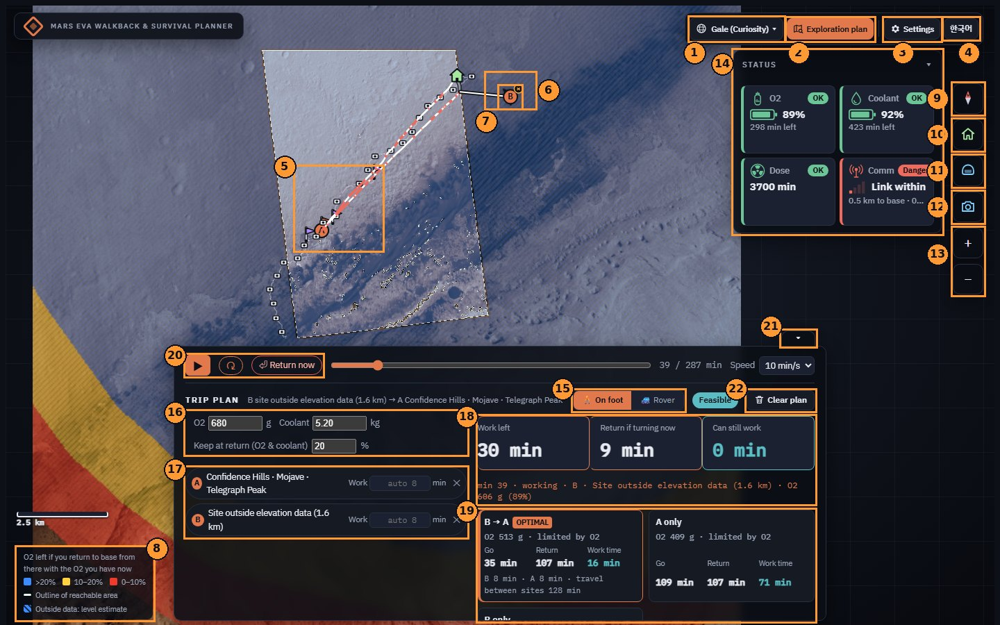
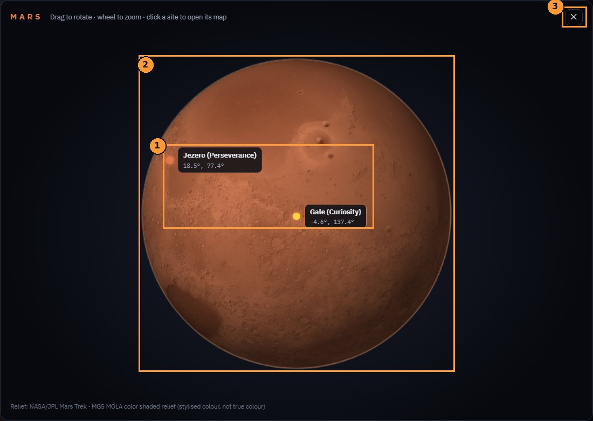
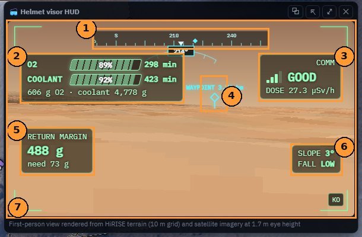

# Mars EVA Walkback & Survival Planner

**NASA Space Apps 2026 · Interplanetary Survival Guide: Martian Map**

> ### If something breaks right now, can the astronaut still walk back to base?

A 10 m map of Mars that shows **where an EVA crew can still get home alive** with the oxygen, coolant
and radiation margin they have left, and **the safest way back** from any point.

**▶ Demo:** [`reports/18-eva-walkback-demo.html`](reports/18-eva-walkback-demo.html) — one HTML file, open it in a desktop browser (best at 1440 px wide or more).

---

### Key features

- **Walk-back zone:** every 10 m cell is checked for O2, coolant, dose and comms on the real return route; colours show the O2 left after a round trip (>20 %, 10–20 %, 0–10 %).
- **Exploration planner:** enter O2, coolant and a return reserve, pick up to three sites, and it chooses the **optimal visit order and work time per site**.
- **Playback with turn-back:** the plan plays minute by minute with a shrinking zone, a **turn-back alarm** and a **Return now** button.
- **Hard-to-reach sites:** impassable sites are reached by the gentlest route; sites outside the elevation data use a level-ground estimate.
- **Helmet visor:** first-person view from the terrain model with heading, O2/coolant bars, comms and return margin.

### How to use

**Top bar**
1. **Region** — opens the 3D Mars globe (below) to pick Gale, Jezero or Aram Chaos. Switching clears the picked sites.
2. **Exploration plan** — hover to see how to pick sites.
3. **Settings** (gear) — scenarios, O2 and coolant sliders, solar particle event, model corrections (regolith, dune factor), map layers. Opens from the right.
4. **Language** — English / Korean.

**Map**

5. **Science sites** (flags) — places the rovers actually studied. Hover a flag for what was done there; click it to add it to the plan (up to three: A, B, C). Any other point can be picked too.
6. **Site outside the elevation data** — joins the route at the best strip-edge cell (level-ground estimate). Click it or its × to remove it.
7. **Crew position** — the arrow points in the walking direction during playback.
8. **Legend** — colour = O2 left after base → site → base (>20 %, 10–20 %, 0–10 %); hatched = level-ground estimate outside the HiRISE strip.

**Right tool column**

9. **N** — north up ↔ target up (the current destination points to the top).
10. **Move base** (house) — click, then click the map. A spot cut off by slopes over 20° is moved to the nearest walkable cell by the gentlest route.
11. **Visor** — helmet first-person view (see below).
12. **Roadview** — real rover photos (NASA/JPL Navcam) taken near each stop.
13. **Zoom** — or the mouse wheel; drag to pan.
14. **Status** — O2, coolant, dose and comms right now. Click the title to fold it.

**Trip plan card**

15. **On foot / Rover** — stays visible when the card is folded.
16. **Resources** — O2 (g), coolant (kg) and the reserve (%) to keep on return. The reserve changes work time and the turn-back moment, not the map colours.
17. **Sites and work time** — type minutes per site, or leave blank for the optimal value (shown faintly). × removes the site.
18. **Times** — go, return and work time; during playback: time to the next site, return time from here, work time still possible.
19. **Scenarios** — every subset and order of the picked sites. The one marked **OPTIMAL** (most sites, then longest work time) is used unless you pick another.
20. **Playback** — ▶ play / pause, ↺ restart, **Return now** (stop the plan and walk back from here), speed.
21. **Fold** the card to see more of the map.
22. **Clear plan** (trash) — remove all picked sites.

During playback, scroll below the map for the live chart (heart rate, correction factor k, usable O2 vs O2 needed to return).

1. **Region pins** — Gale (Curiosity), Jezero (Perseverance) and Aram Chaos, at their latitude and longitude; click one to open its map.
2. **Globe** — drag to rotate, wheel to zoom. Relief is NASA/JPL Mars Trek MGS MOLA shaded relief (stylised colour, not true colour).
3. **Close**.

1. **Heading** (0–360°) with base (⌂) and target (◆) marks.
2. **O2 and coolant** — % inside the bar, minutes left beside it.
3. **Comms** — signal strength to the base, and dose rate.
4. **Waypoint** — the next site and its distance; an arrow at the edge when it is off-screen.
5. **Return margin** — O2 left after walking home from here, and the O2 that return needs.
6. **Slope and fall risk** at the current cell.
7. **Drag** the visor to look around 360°; double-click to face the walking direction again. ⧉ opens it as a separate window.

### Why it is credible

- **Measured suit data:** walking cost comes from NASA IST-1/2 reduced-gravity suited walking tests (444 W on level ground).
- **All formulas, with worked examples:** [docs/METHODS.md](docs/METHODS.md) · [한국어](docs/METHODS.ko.md); terrain factor η: [docs/TERRAIN.md](docs/TERRAIN.md) · [한국어](docs/TERRAIN.ko.md).
- **Independently verified:** the model was re-derived in [`walkback_verification/`](walkback_verification/), and the demo matches it (**Gale, 150 g O2 → 9.72 km²**).
- **Model choice matters:** the older Pandolf model gives **2× the area**, so the comparison switch is built into the demo.

### NASA data

HiRISE 1 m DTMs and orthoimages · MRO CTX mosaics (surroundings) · Curiosity and Perseverance traverses and Navcam images ·
Mars 2020 sample list · JPL Mars Trek THEMIS · Curiosity RAD.
Sites: **Gale**, **Jezero delta**, **Aram Chaos**.

### Observed data vs. models

| Observed / published data (NASA) | Models and scenarios (computed or chosen by us) |
|---|---|
| HiRISE 1 m DTMs and orthoimages | Walking metabolism (regression on NASA IST tests, extrapolated to Mars gravity) |
| Curiosity / Perseverance traverses, stops, Navcam raw images | Return routes, walk-back areas, stay times (Dijkstra results) |
| Mars 2020 sample list | Heart-rate and tank-pressure telemetry (synthetic scenarios or CSV input) |
| Curiosity RAD background dose, observed SPE ×2.9 | 1 mSv dose budget, terrain shielding proxy, large SPE multipliers |
| Apollo 15–17 PLSS consumables (680 g O2, 5.2 kg water) | Rover speed and riding metabolism; fall-risk and comm-bar proxies |
| JPL Mars Trek THEMIS night IR | First-person visor rendered from the 10 m terrain (not a photograph) |

### Limitations

- The suit tests ran at 0.12–0.32 g on Earth, not at Mars gravity.
- Telemetry in the demo is synthetic or loaded from CSV.
- Terrain shielding, fall risk and comm bars are proxies, not measurements.

---

Rebuild: `cd code && python build_demo_html.py` · SLAM and terrain-AI research from earlier in the project:
[Martian_SLAM](https://github.com/jstak0804/Martian_SLAM) · Built with an AI coding assistant (Claude Code); all imagery is NASA/JPL-Caltech.
